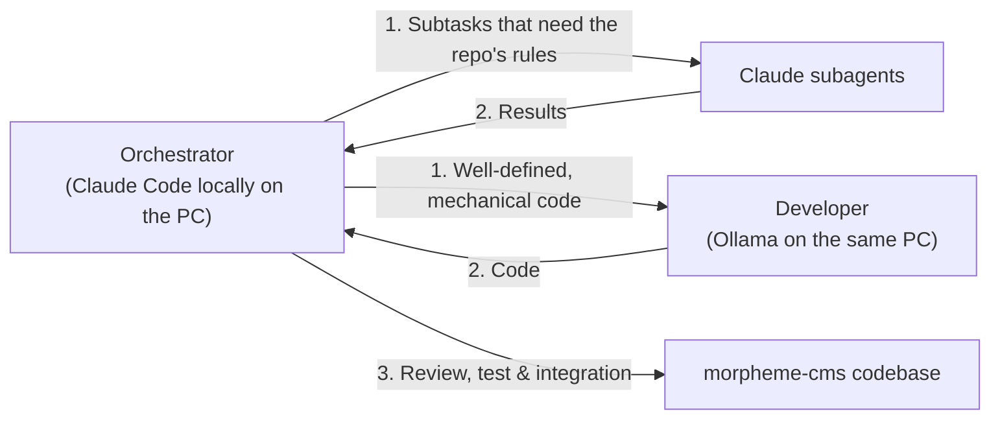

# AGENTS.md – Architecture Framework & Collaboration Model

This document defines the overall architecture, scope, roles and workflows for all AI agents that work in this repository.

---

## 1. Context, Purpose and Scope

Our ecosystem has two completely separate repositories, which must **never** be confused:

1. **`morpheme-appstore` (the store / the distribution server):**
   - Cloudflare Worker-repository (`larsadolfsen/morpheme-appstore`).
   - Works as a private npm registry with Cloudflare D1 (metadata, tokens, keys) and Cloudflare KV (tarballs).
   - Responsible for package distribution and licenses.
   - Contains **no** CMS logic, Astro code or theme implementations.

2. **`morpheme-cms` (this repository – the CMS product itself, `@morphemecms/cms`):**
   - The Astro editor itself, the CMS core and the official default theme.
   - Contains the editor (`src/`, `pages/`), shared libraries (`lib/`), the site's Cloudflare Worker (`worker/`), the default theme (`theme/`), the starter (`starter/`) and the demo (`demo/`).
   - Published on npmjs.com as a public package (`.github/workflows/publish.yml`): every merge to `main` stages a
     test version under the npm tag `next` for `morpheme-staging`; the pull request *Release @morphemecms/cms*, which
     Changesets keeps open, is merged when the owner writes `/release` (`.claude/skills/release/SKILL.md`), and stages `latest`. A version is only on npm when
     the owner has approved it on npmjs.com with 2FA (*staged publishing*); an agent never approves. Never merge
     the Release PR without the owner's yes.
   - This repository is the only source of the CMS (since 2026-11-05). `larsadolfsen/morpheme-website` installs `@morphemecms/cms` from npm and has no `packages/editor/`; its check fails if that folder comes back. Every change to the editor, the theme *Material*, the Worker, the starter or the demo is a pull request here.

> [!IMPORTANT]
> This repository is **not** the store or the Cloudflare npm registry. All development here concerns the CMS editor, the Astro integration, the default theme Material Design 3 (*Material*) and the related blocks and components.
>
> **Shared theme principle (frontend & backend):**
> Both the site's frontend and the admin editor (`/editor/`) use and share **exactly the same theme** (`theme/styles/global.css`, MD3 tokens, typography and UI components). The editor has no separate font or style system: everything inherits directly from the theme's tokens, surfaces and fonts.

---

## 2. Key Folders & Structure

- **`theme/`**: The official default theme (**Material Design 3 / *Material***).
  - `theme/styles/`: MD3 design tokens (3-tier: `md.ref.*`, `md.sys.*`, `md.comp.*`), typography (Roboto / Roboto Flex), elevation and color scales.
  - `theme/ui/`: M3 UI components (Buttons, Cards, Chips, Dialogs, Top App Bar, Navigation Bar/Rail/Drawer etc.).
  - `theme/blocks/`: Default blocks and their visual look (`View.tsx`, CSS).
- **`demo/`**: The CMS's demo, a made-up site laid over the starter, which the CMS is developed and checked with and which the themes' pictures are taken of (`npx morpheme check:demo`). `npm run build` (`scripts/demo-build.mjs`, not in the package) builds it in `.morpheme/demo/site/` with a copy of the package as npm would pack it, and `wrangler.jsonc` puts it on the Worker `morpheme-demo`. Each branch gets its own Preview of the demo (Cloudflare's Worker Previews, `npx wrangler preview`), and Cloudflare writes its address on the branch's pull request; login and save do not work there. Agents never send the owner a Preview link for a change to the editor (the owner can't sign in there to see it); only for a change visible on the site.
- **`starter/`**: What a new site starts with (the *Deploy to Cloudflare* button).
- **`src/` and `pages/`**: The CMS editor itself and the admin interface.
  - `src/`: React-based editor UI, screens, fields, state management (`store.ts`), live preview (`pagePreview.tsx`) and block registry (`blocks.ts`).
  - `pages/`: Astro pages and routing for the admin interface.
- **`lib/`**: Shared helper functions used by both the editor and the site (block parsing `blocks.mjs`, image cropping `crop.mjs`, status, dates, video handling etc.).
- **`worker/`**: The site's default Cloudflare Worker (login/session, GitHub commit proxy, R2 backup, redirects and scheduled tasks).
- **`bin/`**: The `morpheme` CLI tool for image processing, build hooks and validation.
- **`release-notes/`**: Owner-facing release notes in English and Danish: cards (title, text and a screenshot per language) and lines. Each pull request writes `i18n/<locale>/pending/<id>.json` (and `<id>.webp` for a card); `release:version` moves them to `i18n/<locale>/<version>.json` and `i18n/<locale>/<version>/`. Writing rule: `.changeset/README.md`.

---

## 3. Roles and Division of Work

All development in this repo is run by one orchestrator, who delegates:

### 1. Orchestrator (Claude Code locally on the PC)
- **Where:** the repo's folder on the owner's PC, on the owner's subscription; `/rc` to follow along from the phone.
- **Responsibility:** System architecture, interface design, module contracts, security, quality assurance, overview, breaking down tasks and delegating them.
- **Tasks:**
  - Sets the APIs, component props and types.
  - Specifies tasks clearly for the subagents and the Developer.
  - Validates all received code against the project's standards, WCAG AA, A11y and MD3 rules.
  - Integrates and commits fully tested changes.

### 2. Claude subagents
- **Responsibility:** Bounded or parallel tasks from the orchestrator (search, review, smaller changes); the first choice when the task requires knowing the repo's rules.

### 3. Developer (Ollama on the same PC)
- **Responsibility:** Well-defined, mechanical tasks with a precise specification (boilerplate, tests, translations, rewrites).
- **Model and access:** `qwen3.8:27b` through Ollama's API at `http://127.0.0.1:11434`.
- **Instruction:** Must always receive well-defined requirements and interfaces from the orchestrator, who reviews the code and runs the checks before it is committed.

### 4. Claude in the cloud (claude.ai/code)
- **When:** When the PC is off, or for a task that should run on its own in a clean container. It cannot reach Ollama and lets subagents write the code.

### Collaboration flow
1. **The orchestrator** designs interfaces, defines data models and breaks the task down into concrete steps.
2. **The subagents and the Developer (Ollama)** carry out the subtasks and generate code.
3. **The orchestrator** reviews, tests (see below), sends errors back to whoever wrote the code, and integrates it.
4. **Every pull request has a changeset** (`npx changeset`, or `npx changeset --empty` when nothing a site receives changes): patch, minor or major and a one-line release note in English. See `.changeset/README.md`.

---

## 4. Verification and Test Commands

Before changes are approved or published, verify the following from the root of this repository, on the demo
(`npm run build` builds it in `.morpheme/demo/site/`). CI (`.github/workflows/check.yml`) runs `check`,
`check:screens`, `check:demo` and `check:starter` on every pull request; its job `check` must pass before a merge.

| Command | Description |
| :--- | :--- |
| `npm run check` | Prettier, `check:language`, the unit tests (`npm test`), the package's types (`check:types`), the demo built (`npm run build`, its content checked by the editor's rules) and `check:editor` on it (each page the same after a save). |
| `npm run check:language` | No Danish text outside the language files (i18n/da-DK/); PENDING in scripts/check-language.mjs lists the parts not converted yet. |
| `npm run check:screens` | After `npm run build`: all of the editor's screens open without errors, on a phone and a computer, and all icons exist. |
| `node ../../../bin/morpheme.mjs check:themes` (in `.morpheme/demo/site/`) | The same with each of the other themes. |
| `npm run check:starter` | The starter works as a site with the package from `npm pack`: its own `npm run check` (the site's types and `check:worker`) and its build. |
| `npm run check:demo` | The demo builds with the default theme and follows the editor's rules. |

### Worker rule: no pending I/O promise in module memory

Cloudflare binds each I/O promise (D1, KV, R2, `fetch`) to the request that started it. Worker code (`worker/*.js`)
never keeps a pending I/O promise in module memory for later requests: when the first request stops, every later
request that awaits that promise hangs. Keep only finished results (a flag or a value set after `await`).
`node --test scripts/pending-shared.test.mjs` scans `worker/*.js` for this and fails on it. A deliberate exception
carries the comment `// pending-ok` with the reason.

---

## 5. General Approach: English First

Writing and thinking in English first is an **overall, general approach** across the whole project, the architecture and the collaboration model:

1. **Universal source language (Source of Truth):**
   - English (`en-US`) is always the source language for all data models, schemas, fields, hints, blocks, APIs, code comments, error messages and technical documentation.
   - All other languages (including Danish `da-DK`) are localizing translations (`translations`) of the English reference form.
2. **Communication and reply format:**
   - Agents write to the owner **in English only**: replies, reports, PR descriptions and commit messages. Never add a
     Danish summary or any Danish text, even when the owner writes in Danish. The Danish texts the product needs (the
     `da-DK` translations and release notes) are not affected.
3. **i18n fallback architecture:**
   - The default parts are written in English; their Danish texts are in `defaults/i18n/da-DK/` (collected in `defaults/texts.ts`, the default for `@site/texts`). If a default text lacks its Danish version, `check:content` stops.

---

## 6. Material Design 3: Global Writing & Word Choice

All wording in UI components, buttons and fields follows the specific guidelines for **Content Design: Global Writing & Word Choice** (cf. `https://m3.material.io/foundations/content-design/global-writing/word-choice` and the skill `.agents/skills/word-choice/SKILL.md`).

- **Short, precise sentences in the active form** (Active Voice).
- **Universal terms:** No local abbreviations or unexplained national concepts.
- **M3 canonical terminology:**
  - Toggles and states: `Enabled` / `Disabled`, `On` / `Off` (their Danish labels are in the `da-DK` language files).
  - Document status: `Draft`, `Published`, `Scheduled`, `Hidden`.
  - Action buttons: Active verbs without filler words (`Add tag`, `Edit page`, `Save`).

