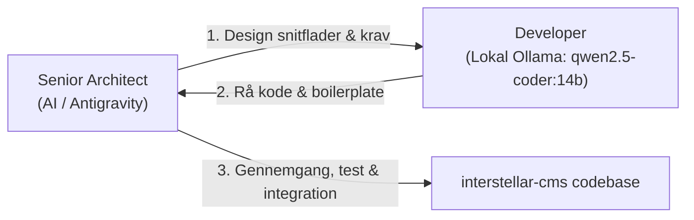

# AGENTS.md – Arkitektonisk Ramme & Samarbejdsmodel

Dette dokument definerer den overordnede arkitektur, afgrænsning, roller og workflows for alle AI-agenter, der arbejder i dette repository.

---

## 1. Kontekst, Formål og Afgrænsning

I vores økosystem indgår to helt adskilte repositories, som **aldrig** må forveksles:

1. **`Interstellar` (Butikken / Distributionsserveren):**
   - Cloudflare Worker-repository (`larsadolfsen/Interstellar`).
   - Fungerer som et privat npm-registry med Cloudflare D1 (metadata, tokens, nøgler) og Cloudflare KV (tarballs).
   - Ansvarlig for pakke-distribution og licenser.
   - Indeholder **ingen** CMS-logik, Astro-koder eller tema-implementeringer.

2. **`interstellar-cms` (Dette repository – Selve CMS-produktet `@interstellarcms/cms`):**
   - Selve Astro-editoren, CMS-kernen og det officielle standardtema.
   - Indeholder editoren (`src/`, `pages/`), fælles biblioteker (`lib/`), sitets Cloudflare Worker (`worker/`), standardtemaet (`theme/`) og test-playgrounden (`playground/`).
   - Når nye versioner er klar og verificeret, bygges og udgives de herfra til butikken via `npm publish`.

> [!IMPORTANT]
> Dette repository er **ikke** butikken eller Cloudflare npm-registryet. Al udvikling her vedrører CMS-editoren, Astro-integrationen, standardtemaet Material Design 3 (*Material*) og de tilhørende blokke og komponenter.
>
> **Fælles tema-princip (Frontend & Backend):**
> Både sitets frontend og administrations-editoren (`/editor/`) anvender og deler **nøjagtig det samme tema** (`theme/styles/global.css`, `theme/styles/fonts.css`, MD3-tokens, typografi og UI-komponenter). Editoren har intet separat font- eller stilsystem: alt arver direkte fra temaets tokens, overflader og lokale Google-fonte.

---

## 2. Nøglemapper & Struktur

- **`theme/`**: Det officielle standardtema (**Material Design 3 / *Material***).
  - `theme/styles/`: MD3 design tokens (3-tier: `md.ref.*`, `md.sys.*`, `md.comp.*`), typografi (Roboto / Roboto Flex), elevation og color scales.
  - `theme/ui/`: M3 UI-komponenter (Buttons, Cards, Chips, Dialogs, Top App Bar, Navigation Bar/Rail/Drawer mv.).
  - `theme/blocks/`: Standardblokke og deres visuelle udtryk (`View.tsx`, CSS).
- **`playground/`**: Isoleret test- og udviklingsmiljø.
  - Kører uafhængigt af produktionssitet via `npm run playground`.
  - Frontend showcase på `http://localhost:4321/` (alle 36 M3-komponenter og lys/mørk tilstand).
  - Administrations-editor på `http://localhost:4321/editor/` (live test af blokke og forhåndsvisning).
- **`src/` og `pages/`**: Selve CMS-editoren og administrationsfladen.
  - `src/`: React-baseret editor UI, skærme, felter, state management (`store.ts`), live preview (`pagePreview.tsx`) og blok-registry (`blocks.ts`).
  - `pages/`: Astro-sider og routing til administrationsfladen.
- **`scripts/check-md3.mjs`**: Automatisk valideringsscript for Material Design 3 compliance.
- **`lib/`**: Fælles hjælpefunktioner delt mellem editor og site (blok-parsing `blocks.mjs`, billedbeskæring `crop.mjs`, status, datoer, video-håndtering mv.).
- **`worker/`**: Sitets standard Cloudflare Worker (login/session, GitHub-commit proxy, R2 backup, redirects og planlagte opgaver).
- **`bin/`**: CLI-værktøjet `interstellar` til billedbehandling, build-hooks og validering.

---

## 3. Roller og Samarbejdsfordeling

Al udvikling i dette repo følger en todelt agent-model:

### 1. Senior Architect (AI / Antigravity)
- **Ansvar:** Systemarkitektur, snitfladedesign, modulkontrakter, sikkerhed, kvalitetssikring, overblik og nedbrydning af opgaver.
- **Opgaver:**
  - Fastlægger API'er, komponent-props og types.
  - Specificerer opgaver klart til Developer.
  - Validerer al modtaget kode mod projektets standarder, WCAG AA, A11y og MD3-regler.
  - Integrerer og committer færdigtestede ændringer.

### 2. Developer (Lokal Ollama, fx `qwen2.5-coder:14b` / `llama3.2`)
- **Ansvar:** Hurtig og tung kodegenerering, boilerplate-kodning, funktionelle delimplementationer og rå komponentudkast.
- **Kommunikation:** Kontaktes via Ollama CLI eller lokal API (`http://127.0.0.1:11434`).
- **Instruks:** Skal altid modtage veldefinerede krav og snitflader fra arkitekten før udførelse.

### Samarbejdsflow
1. **Arkitekten** designer snitflader, definerer datamodeller og bryder opgaven ned i konkrete trin.
2. **Developer (Ollama)** genererer kodeblokke, rå templates eller boilerplate.
3. **Arkitekten** gennemgår, tester (`check:md3` / `playground`), retter eventuelle fejl og integrerer koden.

---

## 4. Verifikations- og Testkommandoer

Før ændringer godkendes eller udgives, skal følgende verificeres:

| Kommando | Beskrivelse |
| :--- | :--- |
| `npm run check:md3` | Kører den fulde Material Design 3 validering (tokens, typografi, spacing, scaffold slots og 36/36 komponenter). |
| `npm run playground` | Starter den lokale Astro-dev server i `playground/` på port `4321` (`/` for komponenter, `/editor/` for backend). |
| `npm run demo` | Starter automatisk demoen med MD3 compliance check og persistent dev-server i baggrunden. |
| `npm run test:editor` | Kører automatiseret Playwright E2E-test af samtlige 55 ruter og underskærme i CMS-editoren (fejlfri rendering og nul crash). |

---

## 5. Sprogarkitektur & Material Design 3 Content Design (English First)

Al tekstproduktion, UI-design og sproglig modellering i dette repository følger de officielle Google Material Design 3 standarder for **Content Design: Global Writing & Word Choice** (jf. `https://m3.material.io/foundations/content-design/global-writing/word-choice` og skillen `.agents/skills/material-content-design/SKILL.md`).

### Grundregler:
1. **English First som kildesprog:**
   - Engelsk (`en-US`) defineres og skrives altid først som det primære referencesprog for samtlige skemaer, felter, hints, blok-beskrivelser, fejlmeddelelser og UI-komponenter.
   - Alle andre sprog (herunder dansk `da-DK`) fungerer som lokaliserende oversættelser (`translations`) af den engelske referenceform.
   - I agentsvar og teknisk dokumentation skrives der altid på engelsk først, efterfulgt af et dansk resumé, når brugeren kommunikerer på dansk.
2. **Global Writing & Word Choice:**
   - **Korte, præcise sætninger i aktiv form** (Active Voice).
   - **Universelle termer:** Ingen lokale forkortelser eller uforklarede nationale begreber.
   - **M3 Kanonisk Terminologi:**
     - Toggles og tilstande: `Enabled` / `Disabled` (dansk: `Aktiveret` / `Deaktiveret`), `On` / `Off` (`Til` / `Fra`).
     - Dokumentstatus: `Draft`, `Published`, `Scheduled`, `Hidden`.
     - Handlingsknapper: Aktive verber uden fyldord (`Add tag`, `Edit page`, `Save`).
3. **Universelt fallback-princip i i18n:**
   - `defaults/texts.ts` indeholder altid den komplette grundordbog for alle standardfelter, så ingen felter i backend nogensinde falder tilbage til uoversat tekst.

