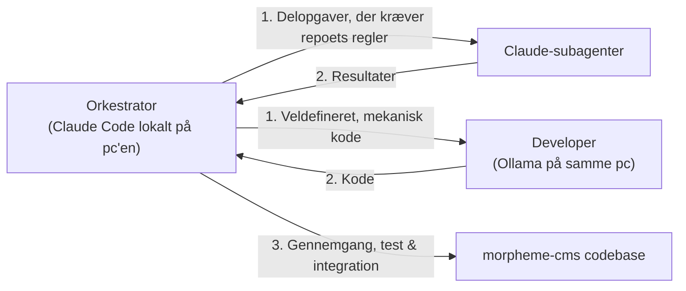

# AGENTS.md – Arkitektonisk Ramme & Samarbejdsmodel

Dette dokument definerer den overordnede arkitektur, afgrænsning, roller og workflows for alle AI-agenter, der arbejder i dette repository.

---

## 1. Kontekst, Formål og Afgrænsning

I vores økosystem indgår to helt adskilte repositories, som **aldrig** må forveksles:

1. **`morpheme-appstore` (Butikken / Distributionsserveren):**
   - Cloudflare Worker-repository (`larsadolfsen/morpheme-appstore`).
   - Fungerer som et privat npm-registry med Cloudflare D1 (metadata, tokens, nøgler) og Cloudflare KV (tarballs).
   - Ansvarlig for pakke-distribution og licenser.
   - Indeholder **ingen** CMS-logik, Astro-koder eller tema-implementeringer.

2. **`morpheme-cms` (Dette repository – Selve CMS-produktet `@morphemecms/cms`):**
   - Selve Astro-editoren, CMS-kernen og det officielle standardtema.
   - Indeholder editoren (`src/`, `pages/`), fælles biblioteker (`lib/`), sitets Cloudflare Worker (`worker/`), standardtemaet (`theme/`), starteren (`starter/`) og demoen (`demo/`).
   - Udgives på npmjs.com som en offentlig pakke (`.github/workflows/publish.yml`): hver merge til `main` lægger en
     testversion klar under npm-tagget `next` til `morpheme-staging`; pull requesten *Release @morphemecms/cms*, som
     Changesets holder åben, flettes, når ejeren skriver `/release` (`.claude/skills/release/SKILL.md`), og lægger `latest` klar. En version er først på npm, når
     ejeren har godkendt den på npmjs.com med 2FA (*staged publishing*); en agent godkender aldrig. Flet aldrig
     Release-PR'en uden ejerens ja.
   - This repository is the only source of the CMS (since 2026-11-05). `larsadolfsen/morpheme-website` installs `@morphemecms/cms` from npm and has no `packages/editor/`; its check fails if that folder comes back. Every change to the editor, the theme *Material*, the Worker, the starter or the demo is a pull request here.

> [!IMPORTANT]
> Dette repository er **ikke** butikken eller Cloudflare npm-registryet. Al udvikling her vedrører CMS-editoren, Astro-integrationen, standardtemaet Material Design 3 (*Material*) og de tilhørende blokke og komponenter.
>
> **Fælles tema-princip (Frontend & Backend):**
> Både sitets frontend og administrations-editoren (`/editor/`) anvender og deler **nøjagtig det samme tema** (`theme/styles/global.css`, MD3-tokens, typografi og UI-komponenter). Editoren har intet separat font- eller stilsystem: alt arver direkte fra temaets tokens, overflader og skrifter.

---

## 2. Nøglemapper & Struktur

- **`theme/`**: Det officielle standardtema (**Material Design 3 / *Material***).
  - `theme/styles/`: MD3 design tokens (3-tier: `md.ref.*`, `md.sys.*`, `md.comp.*`), typografi (Roboto / Roboto Flex), elevation og color scales.
  - `theme/ui/`: M3 UI-komponenter (Buttons, Cards, Chips, Dialogs, Top App Bar, Navigation Bar/Rail/Drawer mv.).
  - `theme/blocks/`: Standardblokke og deres visuelle udtryk (`View.tsx`, CSS).
- **`demo/`**: CMS'ets demo, et opdigtet site lagt oven på starteren, som CMS'et udvikles og tjekkes med, og som temaernes billeder tages af (`npx morpheme check:demo`). `npm run build` (`scripts/demo-build.mjs`, ikke i pakken) bygger den i `.morpheme/demo/site/` med en kopi af pakken, som npm ville pakke den, og `wrangler.jsonc` lægger den på Workeren `morpheme-demo`. Hver branch får sin egen Preview af demoen (Cloudflares Worker Previews, `npx wrangler preview`), og Cloudflare skriver dens adresse på branchens pull request; login og gem virker ikke dér.
- **`starter/`**: Det, et nyt site begynder med (knappen *Deploy to Cloudflare*).
- **`src/` og `pages/`**: Selve CMS-editoren og administrationsfladen.
  - `src/`: React-baseret editor UI, skærme, felter, state management (`store.ts`), live preview (`pagePreview.tsx`) og blok-registry (`blocks.ts`).
  - `pages/`: Astro-sider og routing til administrationsfladen.
- **`lib/`**: Fælles hjælpefunktioner delt mellem editor og site (blok-parsing `blocks.mjs`, billedbeskæring `crop.mjs`, status, datoer, video-håndtering mv.).
- **`worker/`**: Sitets standard Cloudflare Worker (login/session, GitHub-commit proxy, R2 backup, redirects og planlagte opgaver).
- **`bin/`**: CLI-værktøjet `morpheme` til billedbehandling, build-hooks og validering.

---

## 3. Roller og Samarbejdsfordeling

Al udvikling i dette repo styres af én orkestrator, der uddelegerer:

### 1. Orkestrator (Claude Code lokalt på pc'en)
- **Hvor:** repoets mappe på ejerens pc, på ejerens abonnement; `/rc` for at følge med fra telefonen.
- **Ansvar:** Systemarkitektur, snitfladedesign, modulkontrakter, sikkerhed, kvalitetssikring, overblik, nedbrydning og uddelegering af opgaver.
- **Opgaver:**
  - Fastlægger API'er, komponent-props og types.
  - Specificerer opgaver klart til subagenterne og Developer.
  - Validerer al modtaget kode mod projektets standarder, WCAG AA, A11y og MD3-regler.
  - Integrerer og committer færdigtestede ændringer.

### 2. Claude-subagenter
- **Ansvar:** Afgrænsede eller parallelle opgaver fra orkestratoren (søgning, gennemgang, mindre ændringer); førstevalget, når opgaven kræver at kende repoets regler.

### 3. Developer (Ollama på samme pc)
- **Ansvar:** Veldefinerede, mekaniske opgaver med en præcis specifikation (boilerplate, tests, oversættelser, omskrivninger).
- **Model og adgang:** `qwen3.8:27b` gennem Ollamas API på `http://127.0.0.1:11434`.
- **Instruks:** Skal altid modtage veldefinerede krav og snitflader fra orkestratoren, som gennemgår koden og kører tjekkene, før den committes.

### 4. Claude i skyen (claude.ai/code)
- **Hvornår:** Når pc'en er slukket, eller til en opgave, der skal køre for sig i en ren container. Den når ikke Ollama og lader subagenter skrive koden.

### Samarbejdsflow
1. **Orkestratoren** designer snitflader, definerer datamodeller og bryder opgaven ned i konkrete trin.
2. **Subagenterne og Developer (Ollama)** udfører delopgaverne og genererer kode.
3. **Orkestratoren** gennemgår, tester (se nedenfor), sender fejl tilbage til den, der skrev koden, og integrerer den.
4. **Hver pull request har en changeset** (`npx changeset`, eller `npx changeset --empty`, når intet, et site får, ændres): patch, minor eller major og én linjes release note på engelsk. Se `.changeset/README.md`.

---

## 4. Verifikations- og Testkommandoer

Before changes are approved or published, verify the following from the root of this repository, on the demo
(`npm run build` builds it in `.morpheme/demo/site/`). This repository has no `npm run check` script yet: run its
parts (`npx prettier --check .`, `node --test` over the `*.test.mjs` files, `npm run build`).

| Kommando | Beskrivelse |
| :--- | :--- |
| `npm run check` | Prettier, typerne, `check:content` (editorens regler), `check:editor` (samme side efter en gem) og `check:worker`. |
| `npm run check:screens` | Efter `npm run build`: alle editorens skærme åbner uden fejl, på en telefon og en computer, og alle ikoner findes. |
| `npm run check:themes` | Det samme med hvert af de andre temaer. |
| `npm run check:starter` | Starteren virker som et site med pakken fra `npm pack`. |
| `npx morpheme check:demo` | Demoen bygger med standardtemaet og følger editorens regler. |

### Worker rule: no pending I/O promise in module memory

Cloudflare binds each I/O promise (D1, KV, R2, `fetch`) to the request that started it. Worker code (`worker/*.js`)
never keeps a pending I/O promise in module memory for later requests: when the first request stops, every later
request that awaits that promise hangs. Keep only finished results (a flag or a value set after `await`).
`node --test scripts/pending-shared.test.mjs` scans `worker/*.js` for this and fails on it. A deliberate exception
carries the comment `// pending-ok` with the reason.

---

## 5. Generel Tilgang: English First

At skrive og tænke på engelsk først er en **overordnet og generel tilgang** på tværs af hele projektet, arkitekturen og samarbejdsmodellen:

1. **Universelt kildesprog (Source of Truth):**
   - Engelsk (`en-US`) er altid kildesproget for samtlige datamodeller, skemaer, felter, hints, blokke, API'er, kode-kommentarer, fejlbeskeder og teknisk dokumentation.
   - Alle andre sprog (herunder dansk `da-DK`) er lokaliserende oversættelser (`translations`) af den engelske referenceform.
2. **Kommunikation og svarform:**
   - I al AI-agent-kommunikation, tekniske rapporter og kodebesvarelser skrives der **altid på engelsk først**.
   - Når der kommunikeres med en dansksproget bruger, følger et kort dansk resumé umiddelbart efter den engelske gennemgang.
3. **i18n Fallback-arkitektur:**
   - Pakkens centrale standardordbog `defaults/texts.ts` danner det faste referencefundament for alle standardfelter, så ingen komponenter i editoren eller sitet nogensinde falder tilbage til uoversat tekst.

---

## 6. Material Design 3: Global Writing & Word Choice

Al tekstformulering i UI-komponenter, knapper og felter følger de specifikke retningslinjer for **Content Design: Global Writing & Word Choice** (jf. `https://m3.material.io/foundations/content-design/global-writing/word-choice` og skillen `.agents/skills/word-choice/SKILL.md`).

- **Korte, præcise sætninger i aktiv form** (Active Voice).
- **Universelle termer:** Ingen lokale forkortelser eller uforklarede nationale begreber.
- **M3 Kanonisk Terminologi:**
  - Toggles og tilstande: `Enabled` / `Disabled` (dansk: `Aktiveret` / `Deaktiveret`), `On` / `Off` (`Til` / `Fra`).
  - Dokumentstatus: `Draft`, `Published`, `Scheduled`, `Hidden`.
  - Handlingsknapper: Aktive verber uden fyldord (`Add tag`, `Edit page`, `Save`).

