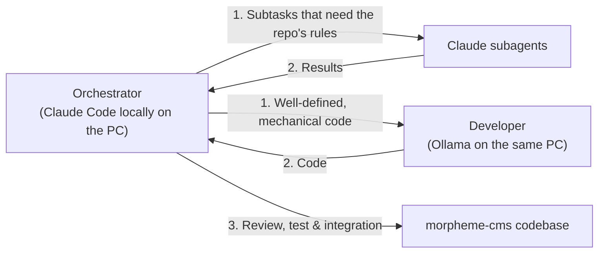

# AGENTS.md – Architecture Framework & Collaboration Model

This document defines the overall architecture, scope, roles and workflows for all AI agents that work in this repository.

---

## 1. Context, Purpose and Scope

Our ecosystem has two completely separate repositories, which must **never** be confused:

1. **`morpheme-appstore` (the store / the distribution server):**
   - Cloudflare Worker-repository (`larsadolfsen/morpheme-appstore`).
   - Works as a private npm registry with Cloudflare D1 (metadata, tokens, keys) and Cloudflare KV (tarballs).
   - Responsible for package distribution and licenses.
   - Contains **no** CMS logic, Astro code or theme implementations.

2. **`morpheme-cms` (this repository – the CMS product itself, `@morphemecms/cms`):**
   - The Astro editor itself, the CMS core and the official default theme.
   - Contains the editor (`src/`, `pages/`), shared libraries (`lib/`), the site's Cloudflare Worker (`worker/`), the default theme (`theme/`), the starter (`starter/`) and the demo (`demo/`).
   - Published on npmjs.com as a public package (`.github/workflows/publish.yml`): every merge to `main` stages a
     test version under the npm tag `next` for `morpheme-staging`; the pull request *Release @morphemecms/cms*, which
     Changesets keeps open, is merged when the owner writes `/release` (`.claude/skills/release/SKILL.md`), and stages `latest`. A version is only on npm when
     the owner has approved it on npmjs.com with 2FA (*staged publishing*); an agent never approves. Never merge
     the Release PR without the owner's yes.
   - This repository is the only source of the CMS (since 2026-11-05). `larsadolfsen/morpheme-website` installs `@morphemecms/cms` from npm and has no `packages/editor/`; its check fails if that folder comes back. Every change to the editor, the theme *Material*, the Worker, the starter or the demo is a pull request here.

> [!IMPORTANT]
> This repository is **not** the store or the Cloudflare npm registry. All development here concerns the CMS editor, the Astro integration, the default theme Material Design 3 (*Material*) and the related blocks and components.
>
> **Shared theme principle (frontend & backend):**
> Both the site's frontend and the admin editor (`/editor/`) use and share **exactly the same theme** (`theme/styles/global.css`, MD3 tokens, typography and UI components). The editor has no separate font or style system: everything inherits directly from the theme's tokens, surfaces and fonts.

---

## 2. Key Folders & Structure

- **`theme/`**: The official default theme (**Material Design 3 / *Material***).
  - `theme/styles/`: MD3 design tokens (3-tier: `md.ref.*`, `md.sys.*`, `md.comp.*`), typography (Roboto / Roboto Flex), elevation and color scales.
  - `theme/ui/`: M3 UI components (Buttons, Cards, Chips, Dialogs, Top App Bar, Navigation Bar/Rail/Drawer etc.).
  - `theme/blocks/`: Default blocks and their visual look (`View.tsx`, CSS).
- **`demo/`**: The CMS's demo, a made-up site laid over the starter, which the CMS is developed and checked with and which the themes' pictures are taken of (`npx morpheme check:demo`). `npm run build` (`scripts/demo-build.mjs`, not in the package) builds it in `.morpheme/demo/site/` with a copy of the package as npm would pack it, and `wrangler.jsonc` puts it on the Worker `morpheme-demo`. Each branch gets its own Preview of the demo (Cloudflare's Worker Previews, `npx wrangler preview`), and Cloudflare writes its address on the branch's pull request; login and save do not work there. Agents never send the owner a Preview link for a change to the editor (the owner can't sign in there to see it); only for a change visible on the site.
- **`starter/`**: What a new site starts with (the *Deploy to Cloudflare* button).
- **`src/` and `pages/`**: The CMS editor itself and the admin interface.
  - `src/`: React-based editor UI, screens, fields, state management (`store.ts`), live preview (`pagePreview.tsx`), block registry (`blocks.ts`) and the start screen's widgets (`widgets.ts`, `cmsWidgets.ts`, `widgets/`), shown in a grid by `DashboardGrid.tsx` from the person's saved layout (`dashboardStore.ts`) and edited in place (`DashboardEdit.tsx`, `AddWidget.tsx`, `WidgetSettings.tsx`; the pure parts are `dashboardMoves.mjs` and `widgetValues.mjs`).
  - `pages/`: Astro pages and routing for the admin interface.
- **`lib/`**: Shared helper functions used by both the editor and the site (block parsing `blocks.mjs`, image cropping `crop.mjs`, status, dates, video handling etc.).
  - The app sandbox (contract 4): `appHooks.mjs` (the hook places, `APP_HOOKS`), `appCookies.mjs` (the cookies an app sets with its settings), `appDefinition.mjs` (an app's definition from its `app.json`, `editor.ts` and `texts.json`), `appManifest.mjs` (reads and checks `app.json`), `appPlaces.mjs` (sandboxed, full or no access per app place), `appProblemLines.mjs` (an app's build problems as lines for its page), `appProblems.mjs` (the build's app problems, `dist/_apps/_problems.json`), `reads.mjs` (the site data an app's read scopes give it; test site in `fixtures/reads-site/`), `afterBuild.mjs` (a contract 4 app's after-build step in the sandbox, its files in `dist/_apps/<app>/`), `sandboxHooks.mjs` (runs contract 4 apps' page-colors hook in the sandbox; `apps.mjs` serves the older apps' hooks as `virtual:old-page-colors`), `contentColors.ts` (the content-based color engine on the host, the page-colors hook's helper `contentColors`: a picture's source color and the page's colors, so the hook never runs the engine in its sandbox).
  - `worker/app-problems.js`: `GET /api/apps/problems`, the build's app problems for the editor.
  - `src/AppPlaces.tsx` and `src/AppProblems.tsx`: an app's places and its problems from the last build, on its page.
  - `lib/sandbox/`: `bundle.mjs` (bundles an app's build entry with esbuild and an import allow-list; test apps in `fixtures/`), `runner.mjs` (the runner interface and the hook and after-build limits) and `quickjs.mjs` (runs a bundle in a QuickJS isolate, the security boundary).
- **`worker/`**: The site's default Cloudflare Worker (login/session, GitHub commit proxy, R2 backup, redirects and scheduled tasks).
- **`bin/`**: The `morpheme` CLI tool for image processing, build hooks and validation.
- **`release-notes/`**: Owner-facing release notes in English and Danish: cards (title, text and a screenshot per language) and lines. Each pull request writes `i18n/<locale>/pending/<id>.json` (and `<id>.webp` for a card); `release:version` moves them to `i18n/<locale>/<version>.json` and `i18n/<locale>/<version>/`. Writing rule: section 7 below.

---

## 3. Roles and Division of Work

All development in this repo is run by one orchestrator, who delegates:

### 1. Orchestrator (Claude Code locally on the PC)
- **Where:** the repo's folder on the owner's PC, on the owner's subscription; `/rc` to follow along from the phone.
- **Responsibility:** System architecture, interface design, module contracts, security, quality assurance, overview, breaking down tasks and delegating them.
- **Tasks:**
  - Sets the APIs, component props and types.
  - Specifies tasks clearly for the subagents and the Developer.
  - Validates all received code against the project's standards, WCAG AA, A11y and MD3 rules.
  - Integrates and commits fully tested changes.

### 2. Claude subagents
- **Responsibility:** Bounded or parallel tasks from the orchestrator (search, review, smaller changes); the first choice when the task requires knowing the repo's rules.

### 3. Developer (Ollama on the same PC)
- **Responsibility:** Well-defined, mechanical tasks with a precise specification (boilerplate, tests, translations, rewrites).
- **Model and access:** `qwen3.8:27b` through Ollama's API at `http://127.0.0.1:11434`.
- **Instruction:** Must always receive well-defined requirements and interfaces from the orchestrator, who reviews the code and runs the checks before it is committed.

### 4. Claude in the cloud (claude.ai/code)
- **When:** When the PC is off, or for a task that should run on its own in a clean container. It cannot reach Ollama and lets subagents write the code.

### Collaboration flow
1. **The orchestrator** designs interfaces, defines data models and breaks the task down into concrete steps.
2. **The subagents and the Developer (Ollama)** carry out the subtasks and generate code.
3. **The orchestrator** reviews, tests (see below), sends errors back to whoever wrote the code, and integrates it.
4. **Every pull request has a changeset** (`npx changeset`, or `npx changeset --empty` when nothing a site receives changes): patch, minor or major and a one-line release note in English. See section 7 below.

---

## 4. Verification and Test Commands

Before changes are approved or published, verify the following from the root of this repository, on the demo
(`npm run build` builds it in `.morpheme/demo/site/`). CI (`.github/workflows/check.yml`) runs `check`,
`check:screens`, `check:demo` and `check:starter` on every pull request; its job `check` must pass before a merge.

| Command | Description |
| :--- | :--- |
| `npm run check` | Prettier, `check:language`, the unit tests (`npm test`), the package's types (`check:types`), the demo built (`npm run build`, its content checked by the editor's rules) and `check:editor` on it (each page the same after a save). |
| `npm run check:language` | No Danish text outside the language files (i18n/da-DK/). |
| `npm run check:screens` | After `npm run build`: all of the editor's screens open without errors, on a phone and a computer, and all icons exist. |
| `node ../../../bin/morpheme.mjs check:themes` (in `.morpheme/demo/site/`) | The same with each of the other themes. |
| `npm run check:starter` | The starter works as a site with the package from `npm pack`: its own `npm run check` (the site's types and `check:worker`) and its build. |
| `npm run check:demo` | The demo builds with the default theme and follows the editor's rules. |

### Worker rule: no pending I/O promise in module memory

Cloudflare binds each I/O promise (D1, KV, R2, `fetch`) to the request that started it. Worker code (`worker/*.js`)
never keeps a pending I/O promise in module memory for later requests: when the first request stops, every later
request that awaits that promise hangs. Keep only finished results (a flag or a value set after `await`).
`node --test scripts/pending-shared.test.mjs` scans `worker/*.js` for this and fails on it. A deliberate exception
carries the comment `// pending-ok` with the reason.

---

## 5. General Approach: English First

Writing and thinking in English first is an **overall, general approach** across the whole project, the architecture and the collaboration model:

1. **Universal source language (Source of Truth):**
   - English (`en-US`) is always the source language for all data models, schemas, fields, hints, blocks, APIs, code comments, error messages and technical documentation.
   - All other languages (including Danish `da-DK`) are localizing translations (`translations`) of the English reference form.
2. **Communication and reply format:**
   - Agents write to the owner **in English only**: replies, reports, PR descriptions and commit messages. Never add a
     Danish summary or any Danish text, even when the owner writes in Danish. The Danish texts the product needs (the
     `da-DK` translations and release notes) are not affected.
3. **i18n fallback architecture:**
   - The default parts are written in English; their Danish texts are in `defaults/i18n/da-DK/` (collected in `defaults/texts.ts`, the default for `@site/texts`). If a default text lacks its Danish version, `check:content` stops.

---

## 6. Material Design 3: Global Writing & Word Choice

All wording in UI components, buttons and fields follows the specific guidelines for **Content Design: Global Writing & Word Choice** (cf. `https://m3.material.io/foundations/content-design/global-writing/word-choice` and the skill `.agents/skills/word-choice/SKILL.md`).

- **Short, precise sentences in the active form** (Active Voice).
- **Universal terms:** No local abbreviations or unexplained national concepts.
- **M3 canonical terminology:**
  - Toggles and states: `Enabled` / `Disabled`, `On` / `Off` (their Danish labels are in the `da-DK` language files).
  - Document status: `Draft`, `Published`, `Scheduled`, `Hidden`.
  - Action buttons: Active verbs without filler words (`Add tag`, `Edit page`, `Save`).

## 7. Changesets and release notes

Every pull request into `main` has one file here, made with `npx changeset`: whether it is a `patch`, `minor` or
`major` change of `@morphemecms/cms` (the rules of *Appbutikken* in `morpheme-website`'s `CLAUDE.md`: major only when
something a site has stops working as before) and one line of release note, in English, for a site's owner. A pull
request that changes nothing a site gets (docs, CI, tests only) adds `npx changeset --empty`.

Each merge stages a test version for npm's `next` tag for `morpheme-staging`; the *Release* pull request, merged
when the owner says go, turns the files here into `CHANGELOG.md` and stages `latest`. A staged version is on npm once
the owner approves it with 2FA
(`docs/superpowers/specs/2026-11-03-development-flow-and-releases-design.md`).

### Release notes for owners

A change a site owner sees gets a note in both languages, English (`en-US`) and Danish (`da-DK`). Developer-only changes
get no note. The note's `id` is this changeset's file name without `.md`, for example `brave-cats-run`. A note has one
of two kinds:

- `card` (a *paragraph* on the Morpheme page's "New in" page): a main change, one an owner would go looking for, such as
  a new screen, a new feature or a new way to do something. A title and 1–3 short sentences: what the owner gets first,
  then where to find it. No labels. The screenshot shows only on the start screen's update card; the "New in" page shows
  the title and the text.
- `line`: a smaller change, such as a tweak to something the owner already uses, or a fix. One short sentence with no
  period, shown in the list "Also in this version".

A version can have any number of paragraphs and lines: one paragraph for each main change, and a line for each smaller
one. A note says only what is new in its own version. It never explains a feature from an earlier version again. Several
changes to the same screen or feature are one note.

Only a released version has notes. A note is written as pending in its pull request, while the change is on the `next`
tag. The Release pull request moves everything pending into the file of the version it releases, so the changes of
several merges, and of every test version since the last release, end up in that one released version. A test version
has no notes file of its own: the Morpheme page shows the pending notes under the version it leads to.

Files, per language:

- `release-notes/i18n/<locale>/pending/<id>.json`: the note. A `card` has `id`, `kind`, `title` and `text`. A line has
  `id`, `kind` and `text`.
- `release-notes/i18n/<locale>/pending/<id>.webp`: the screenshot. Only for a `card`.

Screenshot: the editor 375 CSS pixels wide, at most 400 CSS pixels high, device scale factor 2, so 750 px wide and at
most 800 px high. Crop it to the part that changed. Save it as WebP, at most 200 KB. Take one per language, with the
editor in that language.

Writing rule: the skill `site-editor-writing` (in `larsadolfsen/morpheme-website`,
`.agents/skills/site-editor-writing/SKILL.md`), the same as for the editor's own texts. In short:

- Say what the owner gets, in the owner's words: the key word first, *you*, present tense, active voice. Use the
  editor's own names for screens and buttons (`src/i18n/`), never internal names (*build*, *Worker*, *KV*).
- Don't open with what the owner wants (*You want to …*, *Sometimes you want …*); say what's new.
- Sentence case, contractions with `’`, no *we*, no em dash, no `!`.
- Write English first, then Danish written as a Danish app says it, not word for word, with the editor's fixed words
  (*Aktiveret*, *Indstillinger*, *hjemmesiden*).
- Keep it short. A card's text is 1–3 sentences. A line is one sentence.

Example paragraph (`card`, English):

> [screenshot of the start screen]
> **Pick up where you left off**
> Your last 3 pages and blog posts now wait at the top of the start screen. Tap one to jump straight back in.

Example lines:

> Also in this version
> - Open website opens in a new window
> - On a phone, the text toolbar no longer scrolls sideways

### Editions

Each minor line is an edition named after a place: one free nature photo from [Unsplash](https://unsplash.com) (never
Unsplash+) and the name of where it was taken, for every version of the line (0.14.0, 0.14.1, … and its test versions).
After an update, the start screen shows the photo and "Morpheme <name> <version>" in a small card; the Morpheme page
shows it under the line's newest version.

- `release-notes/editions/<line>.json` (e.g. `0.14.json`): `name` (the place, short, in the card's headline), `place`
  (the full place per locale, `en-US` and `da-DK`, the card's subhead) and `photo` (`by`, `source` and `license`).
- `release-notes/editions/<line>.webp`: the whole photo, uncropped as on Unsplash, 1280 px wide, at most 200 KB. Its
  page under Licenses shows all of it; the card crops it to 3:2 from the middle: above the text on a phone, beside it
  on larger screens.

A new minor line needs a new edition; a line without one shows no photo. An edition may leave out its `name`, `place`
and `photo.by` when they aren't known: its heading is then "New in Morpheme <version>", and the photo is credited to
Unsplash ("Photo from Unsplash", and "Unsplash" under Licenses).
