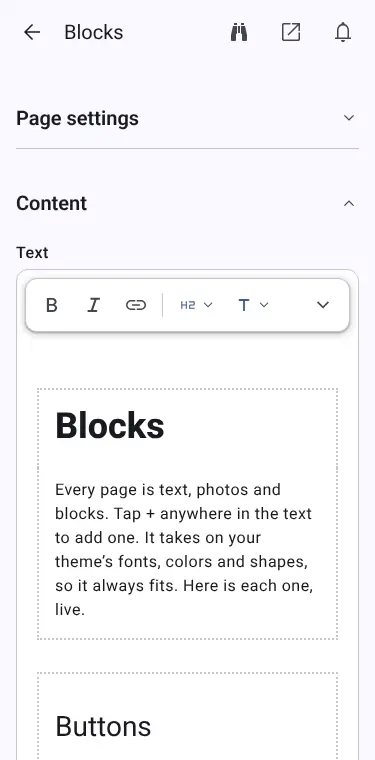
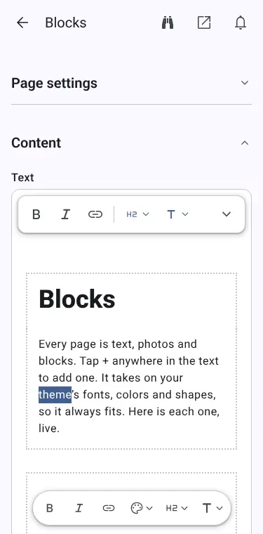
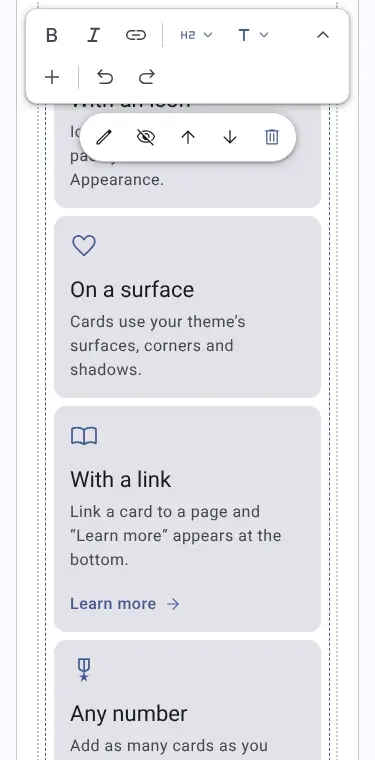
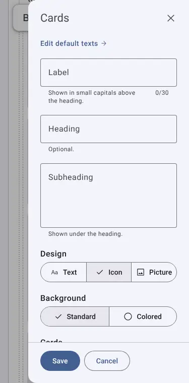
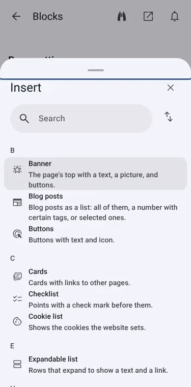
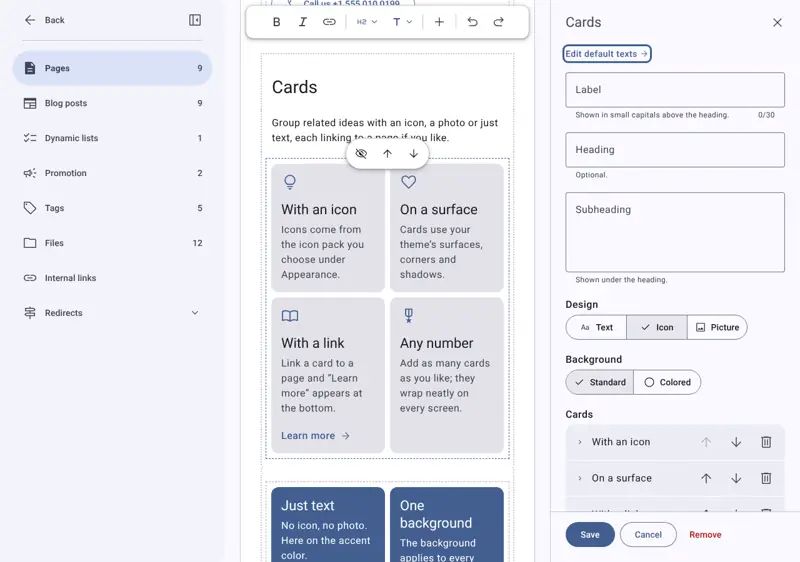

# A more intuitive editor (0.17)

> **Status:** draft of 11 November 2026, written against `main` at `5249b12` (`@morphemecms/cms` 0.15.x). Nothing here is
> built or decided. **0.16 comes first** (`docs/superpowers/plans/2026-11-11-release-0-16.md`); this spec plans work for
> 0.17 and marks what touches the same screens as 0.16.

## Goal

A new site owner can make a page, write a post, add a picture, publish and schedule without help, and always knows what
state their work is in.

## Owner decisions on text and headings (11 November 2026)

The owner's comments, in their words, with how this spec reads them. Where the reading is a guess it is marked and
repeated as a question below.

1. **Keep the current format: text and blocks.** The page stays one text with blocks in it. No new editor model.
2. **Add "Body large" and "Label" to the text styles.** Read as: two new entries in the text-style menu `T`
   (`text.kind`, `text.paragraph` … in `MarkdownEditor.tsx`), next to Heading, Subheading and Normal text. _(Confirmed by the owner: `T` is that menu; `Label` is the small line above a heading, which blocks call `eyebrow` today.)_
3. **Remove all regular headings and text from blocks.** Read as: a block keeps only what is its own (rows, pictures,
   buttons, links), and the heading, subheading, label and intro text come from the text around it, in the text styles
   of decision 2. See finding 10.
4. **An H2 section is a dotted line across the editor, not a box.** Today an H2 with its text is a coloured section with
   `Section settings` (colour: None, Surface, Tint, Primary; `text.sectionColors`). The editor shows a dotted divider
   across the full width at each H2; the colour choice stays in `Section settings`, behind the divider's button.
5. **The editor opens with H1 selected.** A new page opens with the cursor in the H1 line, empty, ready to type the title
   (today `firstHeadingHint` explains it after the fact). It replaces the first-run text hint of finding 6.
   **The title and the H1 follow each other (owner, 11 November):** on a regular page the title is the H1, and the title is
   pre-filled from the H1 as it is today. The title field is hidden from the start; if the owner types in it, the H1 is
   pre-filled with that text, but only while the document is empty, so typing a title never overwrites text that is already
   there.

6. **Edit blocks inline; the panel holds settings only.** A block is drawn as the site shows it and its text is typed in place (a list row's top and bottom line). Settings (icon, picture, link) are in the side panel on desktop, open all the time while the cursor is in the block, and on a phone in a bottom sheet opened with the `Edit` button in the same menu as the text tools. Clicking out returns the block to its live look; an unset icon takes no space. There is no `+` under the rows: the floating menu has `Add above` and `Add below` for the active row.
   This replaces `2026-11-05-block-side-sheet-design.md` for block fields. _(Scope read as block fields only; short pickers such
   as page, link and colour stay sheets until the owner says otherwise.)_

7. **More WYSIWYG than today.** What the owner types is drawn as the site draws it, as far as it can be. See finding 15, and
   question 6 for how it fits decision 4.

8. **Lists are based on Material 3's two list types: Standard and Segmented.** The base list block has exactly these two
   designs (`theme/ui/List.tsx` already has both, `ListKind`). Other row blocks (Cards, Points, Steps and the rest) are
   decided against this base in finding 13. _(Read from the owner's "MD3 has two types, this is our base".)_

9. **Three list blocks in `Insert`, ready-made and built on the base:** **List** (an optional icon or picture on the left;
   a row with a link gets an arrow by itself), **Segmented list**, and **FAQ list** (rows that expand). The owner picks
   one; there is no version to choose afterwards. This replaces the idea of one `Rows` block with a design choice.
10. **A segmented list can end with an optional text button** (for example `See all` or `Book a time`), under the last row.
    _(Owner, 11 November: yes for the Segmented list and the FAQ list. Read as: not on the plain List.)_
    The page in the owner's screenshot is an expanding list in one rounded card with dividers and chevrons, with a text
    button wanted under it.

11. **Lists can show the content of dynamic lists.** A list block can take its rows from a dynamic list instead of typed
    rows, and show them in its list style (finding 16).
12. **The owner can create new lists.** A new list has fields the owner picks: an icon, a title, a body text (and, as the
    owner's example, tags). The list blocks pull on these. Which entries show on which page is decided by tags.
    Not a database builder (owner, 11 November): the owner picks a few fixed fields, for example an icon and two text
    fields, adds items to the list, and a list block on a page shows some of them, for example 3 or 4, chosen by the tags
    set on the items. _(Owner confirmed: tag filter and fixed fields.)_
13. **One Card block with three predefined designs; Price cards and Testimonials stay special** (owner, 11 November).
    Card has the same fields as a list row plus a few card fields, shows only the fields that have content, and has one
    setting, `Design`: Outlined, Elevated or Filled (owner, 11 November: Accent is merged into Filled). On a Filled card
    the owner chooses the background colour. Every theme styles all three, so every card works in every theme, and the
    theme decides how each looks (finding 17).
    The top of every card is one `Media` field (Icon, Image or Video); the first card sets it for the others.
14. **The next list row or card is always shown, empty and ready to edit** (owner, 11 November), for lists and cards. It
    sits after the last item, drawn faded; clicking it starts a new item. It does not replace `Add above` and `Add below`,
    which stay in the floating menu so an item can be added in the middle.

## What was looked at

- **Code and texts:** `src/i18n/en-US/` (`common`, `app`, `library`, `forms`, `parts`, `media`, `text`, `blocks`,
  `blockSettings`, `history`, `dashboard`, `apps`, `advanced`, `preview`), `defaults/collections.ts` (the Status field),
  `defaults/editor.ts` (the menu and Settings), `src/Library.tsx`, `src/FormFrame.tsx`, `src/EntryForm.tsx`,
  `src/StartFab.tsx`, `src/DashboardGrid.tsx`, `src/dashboard.mjs`, `src/widgets/unfinished.tsx`, `src/MainMenu.tsx`.
- **Specs and plans:** the other specs in this folder, and the 0.16 plan, `2026-11-11-mcp-design.md` and
  `2026-11-11-store-sections-design.md`.
- **Judged against:** `CLAUDE.md` section 6 (Material 3 content design: short, active, universal terms, canonical
  states) and the pointer skill `word-choice`. Its target, `site-editor-writing`, is in `morpheme-website`, which this
  session cannot read, so the writing rules are checked only against `CLAUDE.md`.
- **Not done:** the screens were not built or opened (`npm run build`, `check:screens`), so no screenshot was taken. Every
  finding below comes from reading code and texts, and a finding about how a screen *looks* needs a check on the real screen
  before its pull request. No user research exists, and none is claimed: "likely to hesitate" is the author's judgement
  from the texts and flows.

## Findings, ranked by how many owners they affect

Rank 1 affects every owner at their first save; rank 5 only owners who reach developer screens.

### 1. "Save" is "publish", and the editor never says so

- **Evidence:** the Status field has `Draft`, `Hidden`, `Published`, `Scheduled` (`defaults/collections.ts`, `status()`),
  but the button is `Save` / `Save changes` (`common.ts`). A saved page with status Published is live after the build,
  and the message is `… You’ll get a message when the website is updated.` (`common.saved`). A new page has no status
  hint on the screen; `parts.publishedHint` and `draftHint` exist as fields' hints only. The top-bar line says
  `Last changed …` / `Not saved yet` (`app.lastSaved`, `notSavedYet`), which describes the file, not the site.
- **Likely hesitation:** "Did Save publish it?" and "Is my draft safe?". `Published` is also the default for a new page,
  so a half-written page can go live on the first Save.
- **Fix:** (a) name the state in the save bar and top bar: `Published · Last changed today at 1:42 PM`, `Draft · Not on
  the website`, `Scheduled Nov 20 at 8:00 AM`; (b) a new page and post starts as **Draft** (the owner decides; see Q1);
  (c) when the status is Published, label the button `Save and publish`, and `Save draft` otherwise (see Q2); (d) the
  message after a save says what changed *and* whether it is live: `Saved. The page is on the website in 1–2 minutes.`

### 2. The four statuses are not self-explanatory, and "Hidden" is the odd one out

- **Evidence:** `Hidden` hint: `Not shown on the blog or in Google, but can be opened at its address.` (`collections.ts`
  line 386; for a page, line 417). `Draft` hint: `Not shown on the website.`, though a draft is not at its address either.
  The Status field is a narrow select above the title (`EntryForm.tsx`, `STATUS`), the hints show only inside the open
  menu. `Scheduled` has a required `Time` field with the hint `Published at most an hour after.`, which reads as a bug,
  not as the build's delay. CLAUDE.md section 6 lists `Draft`, `Published`, `Scheduled`, `Hidden` as the canonical
  states, so the words are right; the explanation is what is missing.
- **Fix (superseded by question 5):** there are two statuses, `Published` and `Draft`. `Scheduled` becomes a date on
  `Publish`, and `Hidden` becomes the SEO setting `Hide from search engines`. Show the state on every list row (a badge for
  Draft), and the text of the date's hint is `The website updates within an hour of this time.`

### 3. The start screen shows four cards that are empty or quiet on a new site

- **Evidence:** the default dashboard is `cms:continue`, `cms:unfinished`, `cms:blog-rhythm`, `cms:status`
  (`dashboard.mjs`, `DEFAULT_WIDGETS`). On a new site `Continue` says `The pages and posts you edit show up here.`,
  `Unfinished` renders nothing (`unfinished.tsx`: `if (!rows.length && !editing) return null`), `Blog rhythm` offers
  `Write your first post`. The only visible action is the round `Create` FAB (`StartFab.tsx`, `library.createNew`) whose
  menu is `New page` / `New blog post`. There is no sentence that says what to do first.
- **Likely hesitation:** an owner opens the editor and sees mostly empty cards and a lone plus button.
- **Fix:** a first-run card at the top while the site has no page or post of its own: three rows (`Write a page`,
  `Write a blog post`, `Add a picture`, each a link), which goes away on its own and can be dismissed. `Create` stays.
  Plain text above the cards names the site and its state (`Your website is live` / `Updating…`), using `StartStatus`.

### 4. Words that only a developer knows, in the owner's path

- **Evidence (all in `src/i18n/en-US/` or `defaults/`):**
  - `Heading (H1)` in the toolbar (`text.pageHeading`), `The heading (H1) isn’t at the top of the text`, `Canonical URL`,
    `noindex` (`forms.seoRating.*`, `collections.ts` `noindex`/`canonical`): HTML terms in a form for owners.
  - `Block templates` (`common.parts.blocks`) and `Block settings` are two rows under one menu section `Blocks`
    (`defaults/editor.ts`); `Dynamic lists` (`common.parts.lists`) sits under Content next to `Promotion`s, `Tags`, `Files`.
  - Developer-only screens are one tap away on Settings: `Developer`, `Parts`, `Caching and builds`
    (`common.parts.*`), with `R2`, `Workers Paid plan`, `Cloudflare`, `GITHUB_PUBLISH_TOKEN` (`advanced.ts`, `cms.ts`).
  - `Business` holds `CVR number` (`parts.ts`), a Danish register number in the English source (`CLAUDE.md` section 6: no
    local abbreviations).
- **Fix:** keep HTML names in brackets only where the SEO check needs them (`Main heading`, `Page title`), rename
  `noindex` to `Hide from search engines` (already the label; drop the bracket), move `Developer` under a collapsed
  `Advanced` row, and rename `CVR number` to `Company registration number` with the country's name in its hint.
  Whether `Dynamic lists` and `Block templates` can be renamed needs the owner (Q4).

### 5. Two places to do the same thing: the menu and Settings, and two theme stores

- **Evidence:** the main menu has five sections (`Dashboard`, `Content`, `Business`, `Blocks`, `Apps`; `groups` in
  `defaults/editor.ts`). `Logo and icon` is under `Business` (and its text says Appearance in places); `Header`/`Footer`
  are under Settings › Appearance. The theme store is `Appearance › Theme store` (`common.parts.themeStore`) *and* the
  Appstore under `Apps` (`appstore`). An owner looking for "change how my site looks" has `Business` (logo),
  `Settings › Appearance` (colours, theme, header) and `Blocks`.
- **Fix:** one rule for the menu: *what the site says* (Content, Business), *how it looks* (Appearance, moved out of
  Settings into the menu), *what it can do* (Blocks, Apps). Move `Logo and icon` to Appearance. Keep the cog for the
  account, notifications, privacy and Morpheme. **Touches 0.16** (Appstore sections, Settings › Assistants): decide the
  menu once, after 0.16, or 0.17 moves rows that 0.16 just placed (Q3).

### 6. Blocks: where they are, and what the sheet does

- **Evidence:** a block is added from `Insert` in the text toolbar (`text.insert`, `blocks.insert`) and found by search
  (`blocks.searchInsert`); nothing on an empty page says blocks exist, only `Write text here…` (`text.typeHere`).
  A block's card has `Hide on the page` / `Hidden on the page` (`text.hideOnPage`) — a fifth meaning of "hidden", unrelated
  to the status `Hidden`. The side sheet (`2026-11-05-block-side-sheet-design.md`) saves with the page, but its own close
  asks `You have changes that aren’t saved. Do you want to keep them?` (`app.unsavedSheet`), which reads as "saved to the site".
- **Fix:** once the owner's decision 5 (the editor opens on H1) is built, an empty page still shows a one-line hint under the text: `Type text, or tap Insert to add a block.` (the hint is
  `firstHeadingHint` today and goes away after a few opens). Rename the card action to `Don’t show on the page` or, better,
  keep `Hide` and rename the status `Hidden` to `Unlisted` in one pass (Q5). Sheet close: `Keep your changes in the page?` with
  `Keep` / `Discard`.

### 7. Pictures: upload and alt text

- **Evidence:** `Choose picture` (`forms.pickImage`), `Choose a picture` / `Upload a new picture` (`media.pick`,
  `uploadNew`), the section is called `Files` (`common.parts.media`). `Alt text`'s hint is `For screen readers and search
  engines.` (`blocks.picture.altHint`); the fix text under the SEO check is `Tap each picture, choose Edit, and write an alt
  text.` (`seoRating.fixAlt`). `Decorative picture` has an On/Off switch and the hint `Screen readers skip the picture.`
- **Likely hesitation:** `Alt text` is unknown to most owners; the SEO score nags about it before they know what it is.
- **Fix:** hint: `Describe the picture in a few words, for people who can’t see it.` Rename `Files` to `Pictures and files`
  or `Media` (Q4). Show the alt field right after a picture is chosen, not behind Edit.

### 8. Feedback after Save: the build is invisible

- **Evidence:** the save message promises a notification (`common.saved`); the first Save asks the browser for
  permission (`notificationData.ts` `askToNotify`) with no text of the editor's own before the browser's prompt. The
  start screen's `Last published …` / `Publish time unknown` (`library.lastPublished`, `publishUnknown`) is the only
  persistent signal; a failed update says `Restore the previous version under Earlier versions.` (`app.siteNotUpdated`).
- **Fix:** a small `Updating the website…` chip in the top bar from Save until the build finishes (the data is there:
  `siteUpdated` notifies when done), then `Live`. A sentence before the browser's permission prompt: `Get a message when
  your changes are live?` Rename `Earlier versions` to `History` only if the owner agrees (the word is clear; low priority).

### 9. Settings and apps: depth and state words

- **Evidence:** `Settings` is five rows (`appearance`, `developer`, `licenses`, `morpheme`, `privacy`) A–Z, so `Appearance`
  is as far from the menu as `Licenses`. `Apps` and `Appstore` are two rows in one section. `Enabled`/`Disabled` and
  `On`/`Off` are both used (`blockSettings.active`, `.on`; `library.on`), as `CLAUDE.md` allows; `Themes` shows `In use` and
  `Changing to it` (`library.themeInUse`, `themeNext`) — `Changing to it` is unclear without a subject.
- **Fix:** `Changing to this theme`; sort Settings by use, not A–Z; show the installed count on `Apps`.
  **Touches 0.16:** Settings › Assistants, the three Appstore sections.

### 10. Blocks repeat the text editor's own tools

- **Evidence:** nine standard blocks (Cards, Points with icon, Steps, Testimonials, Questions and answers, Blog posts,
  Expandable list, Price cards, Checklist) start with the same `headFields` (`src/standard/head.ts`): `Label`
  (`eyebrow`, max 30), `Heading`, `Subheading`. Their rows have again `Heading` and `Text` (`blocks.list`, `blocks.points`,
  `blocks.steps`: `title: 'Heading'`, `text: 'Text'`). So an owner meets `Heading` as an H2 in the text, as a block's
  head and as a row's heading, three places with three meanings, and the block sheet (`BlockDialog.tsx`) opens with the
  least interesting fields first.
- **Why (owner):** a block's heading can be written like any text, so putting it in the block only adds complexity.
- **Fix:** per decision 3, drop `headFields` from the nine blocks. The block is drawn after the H2 and the text above it
  (`BlockHead.tsx` is then not needed in the theme); the label above the heading becomes the `Label` style. The rows keep
  their own title and text, since a row is data, not page text (owner, 11 November: only the blocks' heads go). A migration moves each existing `eyebrow`, `heading` and
  `intro` into the text above the block, so no page loses content; `check:editor` must show each page the same.

### 11. Text styles: Body large, Label, and the dotted section line

- **Evidence:** the toolbar has `Heading (H1)` (pages only), `Heading`, `Subheading`, `Normal text`, lists and quote
  (`text.ts`). A section is an H2 and what follows (`sectionSettings`); its colour is a box on the site and in the editor.
- **Fix:** decisions 2 and 4. `Body large` is Material 3's body-large role for an intro paragraph; `Label` the
  label-large role. Both are text styles stored in the markdown (the format of `text-colors.mjs` and `section-marker.mjs`
  shows how), and the theme draws them from its tokens, as the shared-theme principle in `CLAUDE.md` requires. In the editor an
  H2 starts with a dotted line across the text column, the colour box is shown only on the site.

### 12. Block cards in the text

- **Evidence:** a block is a card in the text with `Edit` (`text.ts`), `Hide on the page` / `Hidden on the page`; its fields
  open in the side sheet from expanded and a modal sheet below (`BlockDialog.tsx`, `2026-11-05-block-side-sheet-design.md`),
  ending with `Save` (`Insert` for a new block) and `Cancel`, plus `Remove` for a card already in the text. A sheet that is
  closed changed asks `Do you want to keep them?` (`app.unsavedSheet`).
- **Likely hesitation:** `Save` in the sheet is not `Save` of the page: the sheet's button keeps the change in the form, the
  page's button writes to the site, both are called Save. The card's `Edit` is one tap more than tapping the card.
- **Fix:** superseded by finding 14 (inline editing), which removes the sheet for block fields. If it is not built, the fallback is: the sheet's confirm button reads `Done` (an edited block) or `Add block` (a new one), and the page's stays `Save`.
  The whole card opens the sheet (keep `Edit` as the accessible name). With decision 3 most blocks have only their rows, so
  the sheet is shorter and can open at its full height on a phone.
  The picker's `Insert` list keeps its search, order and group filter (`BlockDialog.tsx`), but shows a one-line hint and a
  small picture per block, which `Preview` (`ui.tsx`) already draws.

### 13. Many blocks are the same list in a different design

- **Evidence:** the standard blocks in `Insert` are Banner, Buttons, Cards, Checklist, Expandable list, Links, List,
  Notice, Points with icon, Price cards, Questions and answers, Steps, Testimonials, Video, Blog posts and Cookies
  (`src/standard/`, `blocks.ts` texts). Seven of them are rows of the same few fields:
  - **Cards, List, Points with icon, Steps, Links, Checklist:** each is a list of rows with a `Heading` and a `Text`
    (Checklist: only `Text`), most with an `Icon` and an optional `Page` link. Their hints are near-synonyms
    (`Cards with links to other pages`, `Rows under each other with a heading and a text`, `Points with an icon, a heading,
    and a text`, `Numbered steps with heading and text`, `Points with a check mark before them`). Cards even has a
    `Design` (Text, Icon, Picture) and List a `Design` (Standard, Segmented), so a design choice already exists inside two of them.
  - **Questions and answers, Expandable list:** both are rows that expand; one has `Question`/`Answer`, the other `Heading`/`Text`/`Page`.
  - **Testimonials, Blog posts:** both are lists filled from the site's content (tags, selected, all).
- **Likely hesitation:** the picker is one flat A–Z list (`BlockDialog.tsx`: order A–Z, Z–A or by group, where "group" means
  the standard blocks or an app), so an owner who wants "a few boxes with an icon" must open Cards, Points with icon and List
  to see which fits.
- **Fix, in two steps:**
  1. **Group in the picker (no model change).** Under `Insert`, standard blocks get headings by what they do:
     `Rows and cards` (Cards, List, Points with icon, Steps, Checklist, Links), `Questions` (Questions and answers,
     Expandable list), `From your content` (Testimonials, Blog posts), `Prices`, `Banner and buttons` (Banner, Buttons,
     Notice, Video), `Other`. Each block keeps its picture and hint; hints say how it differs from its neighbours
     (`Numbered`, `With a check mark`, `With a picture`). Apps keep their own groups.
  2. **Build on the base (owner decision 8).** The list block has the two M3 types, Standard and Segmented, and starts as
     Standard. The other designs are either variants of it or separate blocks; which is open (question 6). Older text:
  Owner decision 9 settles the shape: three ready-made blocks, List, Segmented list and FAQ list. **Steps is a special block (owner,
  11 November) and stays as it is, not folded into List.** **Links fold into List (owner,
  11 November):** a row with a link gets the arrow; the group headings of today's Links block are lost unless a row can be
  a small heading (to decide when it is built). **Not covered yet:** the Expandable list's page link. Cards fold into
  the Card block (finding 17); Price cards and Testimonials stay special (owner, 11 November); Blog posts become a dynamic
  Card. Older text:
  3. **Merge the rows (model change, owner's call).** One block `Rows` with a `Design` choice: Cards, List, Points, Steps,
     Checklist, Links; and one `Questions` block with a `Display` choice (open, or expanding). A migration maps each
     existing block to its design, so no page changes look or content. Fewer blocks to choose from, one set of row fields to
     learn and one block sheet. The cost: a theme draws each design today (`theme/blocks/*`), so the merge touches every theme
     and the demo, and `check:themes` must pass.

### 14. Edit a block inline

- **Evidence:** block fields open in a modal side sheet below `medium` and a standard side sheet from it
  (`sheetPlacement.mjs`, `BlockDialog.tsx`); the page is narrowed beside it (`[data-side-panel]`, `.editor-side-sheet` in
  `editor.css`). The sheet has its own `Save`/`Insert`/`Cancel`/`Remove` and its own unsaved question (`app.unsavedSheet`),
  a second save model beside the page's (finding 12). The owner chose the side sheet on 5 November
  (`2026-11-05-block-side-sheet-design.md`) after full-screen fields, and on 11 November chose inline editing.
- **Design:** tapping a block's card folds its fields out under the card, in the text, with the card's own header (name of the
  block, Remove, Hide on the page, Move up/down) above and the rest of the text pushed down. Only one block is open at a
  time; opening another folds the first. There is no `Save`, `Cancel` or `Insert` of its own: a change is part of the page's
  form and is saved with the page's `Save`, and `Undo` in the text toolbar undoes it. A new block is added where the cursor is
  from `Insert` (the picker, still a sheet) and arrives open with its required fields marked.
- **Owner's final shape (11 November):** supersedes the fold-out below. Text is typed in the drawn block; the side panel (desktop, always open while the block is active) or the bottom sheet (phone, `Edit` button in the text menu) holds only settings. The panel must keep the page's single save model (no `Save` or `Cancel` of its own).
- **Active row:** a new list is added selected, with its first row active. Only the active row shows its empty fields (icon or picture slot, top line, bottom line, link), so the owner sees what can be filled in. The other rows show their live look. When the owner clicks out, empty fields disappear.
- **Next row (owner, 11 November, decision 14):** after the last row the list always shows one more row, empty and faded, ready to edit. Clicking it makes it the active row and a new empty one appears after it. It is not saved, and not shown on the site, until it has content, and it is not the `+` under the rows that decision 6 removed: it is the next row itself. `Add above` and `Add below` stay in the floating menu (below) for adding in the middle.
- **Menu for a selected list:** while a list is selected, the floating menu shows `Add above` and `Add below` (and on a phone `Edit`). They add an empty row next to the active row, which becomes active. There is no `+` under the rows. Rows are sorted with `Move up` and `Move down` in the same menu, and on desktop also with a drag handle on the active row's left edge. On a phone the four row actions (`Add above`, `Add below`, `Move up`, `Move down`) sit under one `Row` menu beside `Edit`. `Add above`, `Add below`, `Move up` and `Move down` show only when the active row has content. While the list has no content, the menu shows a dynamic icon instead, which opens the panel on the dynamic settings (`Rows from`, tag filter, `How many`). Once a row has content the icon is gone: a list is typed by hand or pulled from a dynamic list, never both. A dynamic list drops the row actions and shows `Edit list` and a way back to typing rows by hand.
- **One pattern for all blocks:** the list is the first case, not the exception. Every block is drawn as the site shows it, its text is typed in place, the floating text menu shows that block's actions while it is selected (a list: `Add above`, `Add below`, `Edit` on a phone), and its settings sit in the side panel on desktop or the bottom sheet on a phone. This replaces today's block cards and sheets. **The floating menu is context aware (owner, 11 November):** it shows only what applies where the cursor is. In normal
  text it has the text tools, as today. In a block's text field it has the tools that field allows, then the block's
  actions (a list or card: `Add above`, `Add below`, `Move up`, `Move down`, the dynamic icon). With a block selected and
  no field focused it has only the block's actions and `Remove`. On a phone the text tools fold into a `Text` menu and the
  block's actions into a `Block` or `Row` menu, beside `Edit`, so the menu never overflows. Which fields allow formatting
  (for example bold, italic and a link in body text, none in titles) is settled when it is built.
- **Rows:** a row is a nested fold-out inside the open block (heading, text, icon, page), with drag handles or Move up and down,
  and `Add row` at the end. This is where finding 13's single row model pays off: one row editor for all designs.
- **Preview:** the card shows the block as the site draws it (`Preview`) above or beside its fields, so the owner sees the
  change while typing. Beside only when the text column is wide enough; below it above.
- **Dynamic list on a page (owner's flow, 11 November):**
  1. The owner adds a list and presses the dynamic icon in the floating menu.
  2. The side panel turns into the dynamic settings; on a phone the bottom sheet opens with them.
  3. The owner chooses which dynamic list the data is pulled from.
  4. In the dynamic settings the owner can choose a tag to filter by (and `How many`).
  5. The owner clicks a field in a row (top line, bottom line, icon or picture, link). A submenu opens on desktop, and a bottom sheet on a phone, with the fields of the chosen list, and the owner picks which one is shown there.
  6. The block updates live on every change, so it always shows how it will look on the page.
  The content of a dynamic list (its items and their fields) is edited only on the dynamic list's own page, never in the block. In the block the owner chooses which list, which tag and which field is shown where; the rows are not typed in place, so the row actions (`Add above`, `Add below`, `Move up`, `Move down`) do not apply to a dynamic block. `Edit list` on the block opens the list's page. A dynamic block has an option `Show all`. When the list has more matching items than `How many`, a text button under the last row (for example `Show all`) shows the rest.
  **The dynamic list's own page:** under `Lists` in the menu the owner presses `New list` and names it, and picks its fields from Icon, Title, Body text, Picture, Link and Tags. The owner adds items, each with the chosen fields and its tags. Items are added, sorted and deleted on this page, and an item edited here changes on every page that shows the list. Removing a field keeps its data until the owner confirms.
- **Design rules (UX and Material Design 3):**
  1. A list pulled from a dynamic list shows its state on the block (`From Services · tag home · 3 items`) with `Edit list`, because its rows cannot be edited in place.
  2. A block pulled from a dynamic list takes the word `Dynamic` in its name: `List` becomes `Dynamic list`, `Cards` becomes `Dynamic cards`. The picker has no separate dynamic entries and stays short; the dynamic icon in the floating menu is how an empty block becomes dynamic.
  3. The dynamic icon is a shortcut. The panel always shows `Rows from`, and switching to dynamic drops typed rows, so it asks first or offers `Undo`.
  4. Icon buttons have a tooltip and an accessible label (M3 icon button). Touch targets are 48 dp or larger, and the floating menu (M3 floating toolbar) never overflows above the keyboard: the row actions fold into one `Row` menu on a phone.
  5. `Enter` in the bottom line adds a row below.
  6. The layout stays stable when the active row changes: fixed line heights, and the empty slots appear with a short transition.
  7. Only a completely empty row is dropped when the list is deselected (an icon or a link counts as content), and `Undo` brings it back.
  8. Below `medium` the settings use the modal bottom sheet and from `medium` the standard side sheet, as today. A selected row and the focused item use M3 state layers and the focus ring.
  9. A row follows the M3 list item: leading icon or picture, headline (top line), supporting text (bottom line), trailing arrow when the row has a link. The pill and the panel are reachable by keyboard, and the active row is announced to screen readers. `Move up` and `Move down` are the keyboard alternative to the drag handle.
- **Cost and risk:** the editor loses the page-stays-usable side panel and gains long fold-outs for blocks with many rows. The
  fields are the editor's own (`fields.tsx`) and need no change; `BlockDialog.tsx`'s picker, section settings and
  `sheetPlacement.mjs` stay for their own steps. Needs a check on a phone at 375 px (keyboard, scroll to the open block) which
  this spec could not make.
- **Not changed:** the pickers (page, link, colour, country code), Preview, Earlier versions, Notifications and widget
  settings keep their sheets. Whether they follow is a later decision.

### 15. How close the editor is to the site, and what is missing

- **Evidence, what is already drawn as the site draws it:** a block is a card with the block as the site draws it
  (`MarkdownEditor.tsx`, "A block in the text as a card"); a section's colour is a box in the text (`editor.css`
  `[data-section-color]`, with readable prose colours); heading and text looks follow the theme (`looks`, `sectionLooks`,
  `headingLooks`); the editor uses the theme's fonts and tokens (the shared theme principle in `CLAUDE.md`).
- **Evidence, what is not:**
  - A page's **title, status, template, tags, short description, top picture** and a post's **date** are fields in a form
    section (`forms.sections`: `Content`, `Page settings`/`Post settings`, `STATUS`/`FIRST` in `EntryForm.tsx`), not on the
    page. The page's title and its H1 are kept together (`titleH1.mjs`), but are two things on two places for a page.
  - The **page frame** (header, menu, footer, the side column and the page's width by template) is not around the text;
    `Preview` shows it in a separate sheet at chosen window sizes (`preview.ts`, `pagePreview.tsx`).
  - **Fields of blocks** are a form beside the card (today a sheet, decision 6 inline), so what is typed and what is drawn are two views.
  - Decision 4 draws an H2 as a dotted line in the editor, which is less like the site than the coloured box is today.
- **Fix, in three steps:**
  1. **The top of the page is the page.** The editor's top area draws the page's head the way the theme does: the H1 (the
     title), the top picture (tap to change), and for a post its date and tags as chips. `Status` stays in the top bar.
     `Page settings` keeps the rest (address, template, Google, share).
  2. **Inline block editing with the block drawn above its fields** (finding 14): the owner edits fields right beneath the
     block as it looks, and where the block's text is plain (a row's heading and text) it is edited on the drawn block itself,
     not in a field.
  3. **The page frame around the text, switched on or off.** A `Show the website around the text` toggle in the top bar
     draws the header and footer in place, and the page's width and side column. It is off on a phone. It replaces the use of
     `Preview` for layout, which stays for the real page.
- **Cost:** step 1 changes the first thing every owner sees in the form and touches the `title`/H1 link; step 3 draws the
  site's header and footer inside the editor, which the theme's `editor/previews.tsx` already does for the header and footer
  screens. The demo and every theme must show the same page (`check:themes`, `check:demo`).

### 16. Lists that pull from dynamic lists, and lists the owner creates

- **Evidence, today:** the `Dynamic lists` screen (`#lists`) lists what `listsShown` in `src/site.ts` returns: the site's own
  (`site.lists`, empty by default in `defaults/editor.ts`), the standard blocks' (`standardLists`: Testimonials, prices) and the
  apps' (`listsOf`, from an app's `lists.ts`). All three are **defined in code**, with their fields. An owner cannot make
  a list. `Tags` (`src/data/categories`, `collections.ts`) already exist and pages, posts and testimonials point to them
  (`relation` with `to: 'categories'`); Testimonials already has `Which testimonials` (All, Buttons with tags, With tags, Marked
  "Show on the front page", Selected). So filtering by tag exists for one block; the list blocks of finding 13 have only typed rows.
- **Design, part A, a list block can use a list:** each of List, Segmented list and FAQ list gets a choice `Rows from`: `Typed
  here` (today) or one of the site's lists. With a list chosen, the block maps the list's fields to the row: icon to the icon,
  title to the heading, body text to the text, a link to the arrow. `Which rows`: all, those with chosen tags, or selected by
  hand (the same choices as `Which testimonials`), and `How many` (all, or a number such as 3 or 4, in the list's order). The same list can be shown on many pages with different tags; one place
  to edit the text.
- **Design, part B, the owner creates lists:** `Dynamic lists` gets `New list`. The owner names it and chooses its fields from
  a fixed set, each optional: `Icon`, `Title` (always), `Body text`, `Picture`, `Link`, `Tags`. The entries are files
  like the other lists' (`src/data/<list>/<slug>.json`); the list's definition is a small file beside them, read by the editor and the build. This
  is **new**: today a list's fields live in code, so the editor must learn collections whose fields come from a file.
  A list the owner made cannot have a field the fixed set lacks (no free field types), so check:content and the build stay
  simple. Deleting a list asks first, and refuses while a block uses it (as `blockSettings.stillOn` does).
- **Tags:** the lists use the same `Tags` as pages and posts, with the same `Create a tag` shortcut, so one tag can mean
  the same on a page, a post and a list entry. Pages show a list's entries by tag; the tag is the owner's way to say "this
  entry belongs on this page".
- **Touches 0.16:** the `Dynamic lists` screen and the app lists (`lists.ts`, contract 4 and 5) are in the same files as
  0.16's store sections (roles). App lists stay as they are and appear in `Rows from` like the owner's. Build after 0.16.
- **Cost and risk:** this is the largest change of the spec: a new kind of stored definition, a screen to make lists, a data
  migration path (none needed for existing lists), and block rendering that reads entries at build time (the site is built from
  files, so the entries must be there when the block is drawn, as testimonials are). The block's preview in the editor needs the
  entries, as `siteOf` in `sitedata.ts` gives them for the others. Needs a design of the `New list` screen before a plan.

### 17. Cards

- **Evidence:** Cards (`standard/cards`, `theme/blocks/cards/LinkCards.tsx`) is outlined link cards with a `Design` (Text,
  Icon, Image) and a `Background` (surface or accent); Price cards, Testimonials (a slider) and the blog post card
  (`theme/components/PostCard.tsx`) are separate. The theme's surface kinds are Material's three: Outlined, Filled and
  Elevated (`theme/ui/Card.tsx`). M3 has no card types beyond these surfaces; link, price and quote cards are our content
  layouts. _(From general knowledge of Material 3, not checked on m3.material.io.)_
- **Fields (owner, 11 November):** Icon or picture or video (one `Media` field), Title, Subhead, Body text, Link, Buttons,
  Badge, Date and Tags. Only fields with content show, as in a list row. **Price and Quote are not card fields:** Price
  cards and Testimonials stay their own blocks.
- **Design:** one setting, `Design`, with three predefined designs, the same in every theme: **Outlined** (a border),
  **Elevated** (raised) and **Filled** (a coloured surface). **Accent is merged into Filled (owner, 11 November):** on a
  Filled card the owner selects the background colour, so today's accent background becomes a Filled card with the
  accent colour. `Inverted` (the inverse surface colours) was left out; it can be added later as a colour of Filled. The
  old `Design` (Text, Icon, Image) and `Background` settings go away, and so does a layout choice: all cards are
  vertical for now, and horizontal can be added later.
- **Filled card colours (owner, 11 November):** a small, fixed selection that we choose, not all the colours of the
  theme. Proposed: **Surface** (the default, a quiet tonal surface), **Primary**, **Secondary** and **Tertiary**
  (Material's `surface-container`, `primary-container`, `secondary-container` and `tertiary-container`). Every theme
  styles the same four names with its own colours, so a Filled card works in every theme and its text stays readable.
  The page's full colour picker is not offered; it could be added later. The final list is confirmed by the owner when it
  is built.
- **Every card works in every theme (owner, 11 November, our philosophy):** the set of designs is fixed and every theme
  must style all of them, so a card never lacks a design when the theme changes and no fallback is needed. The theme
  decides how each design looks: its colours, borders, shadow, corner radius and button widths. A colour such as
  Primary container is right for Material; another theme draws the same named colour in its own way. The theme's styling is applied to
  the card, never stored in it. A theme that leaves a design unstyled fails `check:themes`.
- **Media field:** the top of a card is one `Media` field, with the choice Icon, Image or Video, like the icon field of a
  list. The first card's choice sets the type for every card in the block, so they stay aligned; there is no block setting
  for it. It shows only if it has content. A card without media does not show the media (owner, 11
  November): no placeholder, no empty picture and no blank space, so the card is simply shorter. In the editor only the
  active card shows its empty media slot.
- **Buttons (owner, 11 November):** a card can have buttons at the bottom, none, one or several. Each is a text button or
  a real button (the kinds the Buttons block has: filled, tonal, elevated, outlined and text), with its text and where it
  goes, so the card reuses the Buttons block's button field and its targets (`standard/buttons/fields.ts`).
- **Editing:** the same pattern as lists (finding 14): a new Card block is added selected, with three empty cards and the
  first one active; only the active card shows its empty fields; the next card is always shown empty and faded (decision
  14); the floating menu has `Add above`, `Add below`, `Move up` and `Move down`; settings sit in the side panel on
  desktop and in the bottom sheet on a phone. `Design` is in the panel.
- **Dynamic cards:** as dynamic lists (finding 16): a Card block takes its cards from a dynamic list, is named `Dynamic
  card`, and the owner picks which list field fills which part of the card. The field set of a card list is the one above.
  The blog post card becomes a dynamic Card; Blog posts need no special card.
- **Migration:** Cards with Design Image, Icon and Text become Card with a Media field of Image or Icon, or none;
  Background accent becomes Design Filled with the accent colour, otherwise Outlined. No page changes look.
- **Whole card as a link, or buttons, not both (owner, 11 November):** the whole card can be a link, but if a card is a
  link, buttons cannot be added to it (and a card with buttons cannot be a link). This avoids a link inside a link, which
  is not valid HTML. In the editor, setting a Link hides the buttons, and adding a button hides the Link, each with a
  short hint saying why. A card that has both today asks which to keep when it is migrated. The accessible name of a
  linked card is its title.
- **Button count and width (owner, 11 November):** buttons follow the same pattern as rows and cards (decision 14): the
  next button is always shown, empty and faded, and clicking it adds one. There is no fixed maximum. A Material button
  keeps its own width (its text and padding) and the buttons wrap onto the next line when they do not fit; another theme
  may decide otherwise, for example equal-width buttons.

### 18. Every block follows the same pattern

The owner asked (11 November) for the blocks to be standardised on the list and card pattern without going through each
one. The pattern: the block is drawn as the site shows it; its text is typed in place; what is empty shows only on the
active row, card or button; the next one is always shown empty and faded; the menu is context aware (finding 14); and
settings sit in the side panel on desktop and the bottom sheet on a phone. A block loses its own head fields (decision 3).
The table is a proposal by field name from `src/standard/*`; the exceptions below it are for the owner.

| Block | Typed in place | Settings in the panel | Follows the pattern |
| ----- | -------------- | --------------------- | ------------------- |
| List, Segmented list, FAQ list, Card | rows or cards (title, text, answer) | media, link, buttons, design | yes, finding 14 and 17 |
| Steps | rows (title, text), numbered 1, 2, 3 … | none | yes, rows; its own block (owner, 11 November) |
| Checklist | none: it becomes a `Check list` style in the text toolbar | | no block (owner, 11 November, below) |
| Buttons | each button's label | target, kind, icon | yes, buttons are the rows |
| Notice | the text, in its box | colour, `until` date | yes, one text field |
| Video | the title | the video address | yes, the player is drawn, empty shows an empty frame |
| Banner (hero) | none: it becomes a section setting | | no block (owner, 11 November, below) |
| Expandable list | none: it becomes a Segmented list | | no block (owner, 11 November, below) |
| Price cards | name, price, unit, text, the included list | featured, badge, button targets | yes, cards with a nested list of rows (the included items) and card buttons |
| Table (new) | the cells, with the next row and next column shown empty | header row | yes, a new block (owner, 11 November, below) |
| Testimonials | none: filled from the site's content | layout, which ones | always dynamic (exception 4) |
| Blog posts | none: a dynamic Card | which posts, how many, order | the dynamic Card (finding 17) |
| Cookies | none: filled from the site's data | category | not typed in place |
| Links, Points with icon | folded into List (decisions 8 and 9) | | |

**A table is a new block (owner, 11 November).** Only a few owners need one, and the text menu is already crowded, so it is
a block in `Insert`, not a text style. The cells are typed in place; the next row and the next column are always shown
empty and faded (decision 14); the context-aware menu in a cell offers `Add row`, `Add column`, `Delete row` and `Delete
column`; the panel has a header-row setting, on by default (the first row of a new table is a header row, owner, 11 November). The theme draws it and keeps it readable on a narrow screen (it scrolls
sideways). The site's Markdown renderer already supports tables (`remark-gfm`); whether the editor can create and edit
one is checked when it is built. A table filled from the owner's lists could come later as a dynamic table.

**Exceptions:**

1. **Checklist (settled, owner, 11 November):** it is single lines with a check mark, so it is a list style, not a block.
   The text toolbar gets a `Check list` style next to the bullet and numbered lists, and the Checklist block leaves
   `Insert`. A migration turns each existing Checklist block into a check list in the text, so no page changes look.
   **Steps stays its own block**, with its numbered rows (1, 2, 3 …), each with a title and a text.
2. **Banner (settled, owner, 11 November):** the Banner block goes away. A banner is already an H2 heading, a picture,
   text and a `Buttons` block in one text (`src/standard/hero/fields.ts`), which is what a section is. A section gets the
   banner's settings in its panel (bottom sheet on a phone), next to the colour it has today: a background picture and
   the width of the background. The owner types the heading and text in the section as normal text, and adds a Buttons
   block inside it for buttons. A section is the regular editor, so any block can go in it (owner, 11 November). A migration turns each Banner block into a section with those settings, so no page
   changes look. The text stays readable over a picture because the theme decides it, as on the site today.
3. **Expandable list (settled, owner, 11 November):** an Expandable list is a Segmented list, so the block goes away.
   Each row's page link is the row's Link, and the closing link is the Segmented list's optional text button
   (decision 10). A migration turns each Expandable list into a Segmented list. The rows of a Segmented list are closed by default and expand
   to show their text (owner, 11 November). The panel has a setting for it, for example `Only one open`, which closes the
   open row when another is opened. While editing, the active row is shown open so its text can be typed. The FAQ list has the same setting (owner, 11 November).
4. **Testimonials and Cookies (settled, owner, 11 November):** they have no typed content, so they have nothing to edit in place: the block is a drawn
   preview with settings in the panel, and `Edit testimonials` opens their own list, as `Edit list` does for a dynamic list.

### 19. Spike S3: today's editor on a 375 px phone (11 November)

Checked on the built demo (`Blocks` page) with Playwright at 375 × 760 (touch, mobile) and at 1280 × 900. Pictures: `editor-phone-check/`. No console errors, no horizontal scroll. The soft keyboard is not simulated, so the keyboard questions of decision 14 stay open for a device check.

     

**What works:** the page is readable and blocks are drawn as the site shows them. Insert is a real bottom sheet (full width, search, A-Z, drag handle). Text and floating-menu buttons do not overflow.

**Cramped, hidden, too small or broken:**

1. **A block's settings are not a bottom sheet today.** Below `expanded`, `sheetLook('fields')` is a *modal side sheet*: 319 px of 375 px, full height, with a 56 px strip of dimmed page left. The page behind is not usable and the open block is not visible. Only Insert and section settings are bottom sheets.
2. **Two text toolbars at once.** A fixed bar (two rows when open: `B I link H2 T` and `+ undo redo`, 85 px tall) sits at the top, and a second floating bar (`B I link colour H2 T`) appears under a selection. Bold, Italic and Link are on screen twice; the open top bar takes 85 px of the 760 px height.
3. **Touch targets under 48 dp.** Bold, Italic, Link, Insert, Undo, Redo, Section settings, Show more tools and Close: 40 × 40. The style menus: 54 × 40 and 48 × 40. Colour: 48 × 40. The block menu (`Edit`, `Hide on the page`, `Move up`, `Move down`, `Remove`): 40 × 40 each, 8 px apart. In the sheet: `Edit default texts` link 133 × 20, the Design and Background segmented buttons 38 px high, `Save` and `Cancel` 40 px high, the Insert rows 44 px.
4. **The block menu covers the block.** Tapping a block shows a pill above it that hides the block's first line (the `List` text in the picture). On a phone the settings need a second tap on `Edit`; on desktop a tap opens the panel at once, with its own `Save` and `Cancel`, which decision 6 removes.
5. **Long sheets.** The `Cards` sheet needs about four screens of scrolling: three text fields first, then Design, Background and the cards, with `Save` and `Cancel` pinned at the bottom. A row's `Move up`, `Move down` and delete icons are in the sheet beside a name cut short (`App st…`).
6. **Selection toolbar and pill hang over the text.** The floating bar sits at the bottom of the viewport when the selection is near the top, which is where the soft keyboard will be.

**Recommendation for the in-place pattern on a phone (batches 5 and 6):**

- Keep typing in the drawn block. Do not fold the rows out under the block on a phone; the rows are 301 px wide and the fold-out would be taller than the screen.
- Use **one** floating toolbar, docked above the keyboard (visual viewport), not a bar at the top and a second under the selection. It is context aware as decided: text tools in text, block actions on a block, with `Text`, `Row` and `Edit` as folded menus. Every button is 48 × 48 dp (the pill may keep a 40 dp icon with a 48 dp target) and at most five fit in 375 px, which is why the folding is needed.
- Settings open in a **modal bottom sheet that can sit at half height** (as the Insert sheet does), so the open block stays visible above it. Replace the modal side sheet below `expanded`; this is a change to `sheetPlacement.mjs`, which decision 14 said would stay, and it is cheap because `Insert` already has the component. Keep `Make the sheet taller` for long blocks.
- The sheet holds settings only (icon, picture, link, design, dynamic list), so it is one screen, with no `Save` and `Cancel` of its own (decision 6).
- Scroll the open block to just above the sheet or toolbar when either opens. This and the keyboard need a device check before batch 5 is closed.

## Batches

This plan replaces the earlier letters A–M, which were written before the owner's decisions of 11 November. Each batch
is one pull request (large ones are split as shown) with a release note (`release-notes` skill) where an owner sees the
change, and a changeset as the PM's rule for its base branch allows. Texts change in en-US first, then `da-DK`. Sizes are
rough: S is a day or less, M a few days, L about a week, XL more. The earlier batches B (plain words), C (first run) and D
(build feedback) were started and archived, and nothing of them is on `main`, so they count as not built.

### Spikes first

These are questions that change the plan, each a short read-only investigation or prototype with a written finding.

| Spike | Question | Decides |
| ----- | -------- | ------- |
| S1 | What does the Cloudflare deploy step do when `ci-build` exits early (the third lane for drafts only)? | batch 12 |
| S2 | Can the editor create and edit a table (Milkdown and `remark-gfm`)? | batch 10 |
| S3 | A 375 px phone check of today's editor, the floating menu and a block's bottom sheet, with screenshots. | batches 5 and 6 |
| S4 | Can an app add versions to a page (places, hooks, contract 5)? | the later versions app, not 0.17 |

### The batches

| # | Batch | Contents (findings and decisions) | Depends on | Size | Touches 0.16? | Owner decision |
| - | ----- | --------------------------------- | ---------- | ---- | ------------- | -------------- |
| 1 | **Plain words** | SEO terms, `CVR number`, hints, `Changing to this theme`, alt-text hint; the status words `Published` and `Draft` only (findings 2, 4, 7, 9) | none | S | no | none |
| 2 | **First run** | Start card, empty-page hint, browser-permission sentence (3, 6, 8); no H1 hint (decision 5 replaces it) | none | S | no | none |
| 3 | **Build feedback** | The `Updating…` chip until the site is live (8) | none | S | no | none |
| 4 | **Text styles and the title** | `Body large`, `Label`, `Check list` in the `T` menu; the dotted H2 line (always in the editor); the editor opens on H1; the title and the H1 follow each other (decisions 1, 2, 4, 5; findings 11, 15) | none | M | no | none |
| 5 | **Inline pattern, pilot on List** | The in-place pattern on the List block only: typed in place, the active row, the next empty row, the context-aware floating menu, settings in the side panel and the bottom sheet, no `Save` of its own, head fields removed with the migration (decisions 3, 6, 14; findings 12, 14) | S3 | L | no | none |
| 6 | **Roll the pattern out** | The same on the Steps, Buttons, Notice, Video, Price cards and the FAQ rows; Testimonials and Cookies as a drawn preview with an `Edit` link (18) | 5 | L | no | none |
| 7 | **The list blocks** | List, Segmented list (with `Only one open` and the text button) and FAQ list; Links, Points with icon and Expandable list fold in with migrations; the Checklist block becomes a check list in the text; the `Insert` picker groups (8, 9, 10, 13, 18) | 5, 4 | L | no | none |
| 8 | **Section settings** | Section colours (Surface, Primary, Secondary, Tertiary, none; Tint migrates to Surface); a background picture and width; the Banner block folds into a section with its migration (11, 15, 18; question 8) | 4 | M | no | none |
| 9 | **The Card block** | One Card with three designs (Outlined, Elevated, Filled with a colour), the `Media` field, buttons, whole-card link or buttons, the next empty card, migration of Cards (17) | 5, 8 | L | no | none |
| 10 | **The Table block** | A new block with typed cells, the next row and column, `Add row` and `Add column`, a header row on by default (18) | 5, S2 | M | no | none |
| 11 | **Page head and Preview** | The title, top picture, date and tags drawn in the text for a page and a post; `Preview` full screen with the breakpoint bar and heights (15; question 7) | 4 | L | no | none |
| 12 | **Drafts and Publish** | The draft file in git; `Save`, `Publish changes`, `Unpublish`, `Discard changes`, `Schedule`; two statuses with `unlisted` and `scheduled` migrated and the SEO setting; the `ci-build` lane for drafts only; the version list kept ready for an app (1, 2, question 2) | S1, 1 | XL | maybe: an app place for the version switch | none |
| 13 | **Autosave** | With `Faster editor` on: autosave to R2, written to git on leaving or a long idle, and the status `Saving…` / `Saved` / `Not saved` (question 2) | 12 | L | no | none |
| 14 | **Live and scheduled versions** | The `Live` / `Scheduled` switch, editing either version, and the warning when a page has a waiting version (question 2) | 12 | M | no | none |
| 15 | **Pictures and block flow** | Alt text after a picture is picked, the `Hide on the page` wording, the closing of a sheet (6, 7) | 5 | S | no | none |
| 16 | **Lists from lists** | `Rows from` on the list blocks, the tag filter, `How many`, `Show all`, `Dynamic` in the block name, then `New list` and the list's own page; dynamic cards after the Card block (16, 17) | 7, 9, and 0.16 | XL, split A (a block reads an existing list) then B (`New list`) | **yes**: `Dynamic lists`, app lists | none |
| 17 | **Menu and Settings regroup** | Appearance into the menu, Developer under Advanced, Logo and icon moved; the renames (5, 4, 9; questions 3, 4) | **0.16** | M | **yes**: Appstore, Settings › Assistants | Q3, Q4 |

### Order

1. **Now, in parallel:** batches 1, 2 and 3 (small, no decision, no overlap) and the spikes S1 to S3.
2. **Foundation:** batch 4, then batch 5 (the pilot) once S3 has been read. Batch 5 is where the owner sees the new way of editing for the first time, so nothing after it starts until the owner has seen it.
3. **Then in parallel, as the files allow:** batches 6, 7, 8 and 11. Batches 6 and 7 both change `standard/*` and the block migrations, so one of them goes first (7, the lists). Batch 9 after 8, batch 10 after S2.
4. **Drafts:** batch 12 after S1 and batch 1, then 13 and 14. It touches the form the owner meets every day, so it ships as one release with batch 4 and the owner's note.
5. **After 0.16:** batch 16 (its part A first) and batch 17, which wait for the Appstore and Assistants rows.
6. **Every batch** that changes what a theme draws (5 to 11) must pass `check:themes` and `check:demo`, and each migration is shown to the owner before it is merged.

**The split (settled, owner, 11 November):** 0.17 has batches 1 to 4, 7, 8 and 12 to 14 (words, first run, build
feedback, text styles and the title, the list blocks, section settings, drafts and Publish, autosave, and the live and
scheduled versions). Batches 5, 6, 9, 10, 11 and 15 (the in-place pilot and its roll-out, the Card, the Table, the page
head with the full-screen Preview, and the picture flow) wait for 0.18, after the owner has seen the pilot. Batches 16
and 17 come after 0.16.

## Spike S1: the deploy step when `ci-build` ends early (decides drafts, finding 1 and question 2)

**Question.** Drafts live in git and must not rebuild the site on every autosave. What does Cloudflare do when `ci-build`
(`scripts/ci-build.mjs`) exits 0 early, or non-zero?

**What the repo does today.** A site's `wrangler.jsonc` has `build.command: "npx morpheme ci-build"`
(`starter/wrangler.jsonc`). `ci-build` picks the content or full lane, runs the checks, then always `npm run build`. It
exits non-zero on the first failed step and has no early exit with status 0. `lib/build-lane.mjs` treats an empty diff
as the full lane and any file outside `src/content/`, `src/data/` and `public/images/uploads/` as code.

**What Cloudflare documents** (Workers Builds docs, read 11 November 2026):

- A build runs the build command and then the deploy command (default `npx wrangler deploy`; other branches run the
  Preview command, default `npx wrangler preview`). The build's result is the exit code of these commands.
- Pages states the rule for exit codes outright: any non-zero code marks the build failed, and 0 marks it successful.
  The Workers Builds pages do not repeat it, but their troubleshooting page lists failed builds only as errors of the
  commands. The live site keeps serving its last deployment when a build fails (the check run is red).
- Workers Builds has **Build watch paths** (include and exclude paths, in the dashboard). A push whose changed files are
  all excluded starts no build and gets no check run or commit status.
- Cloudflare skips a queued build when a newer build of the same trigger is queued (24 July 2026).
- The docs say nothing about a build command that exits 0 without producing output.

**Not in the docs, from the repo (not tested on Cloudflare).** An early `exit 0` does not skip the deploy command.
`wrangler deploy` then runs against a fresh checkout. `dist/` is not committed, so the `assets.directory` is missing and
the deploy most likely fails, so the build shows red. Exiting early is therefore not a third lane. The only safe early
exit is one that still leaves a valid `dist/`, which means building anyway and saves nothing.

**Recommendation.**

1. Keep drafts in a folder of its own (for example `src/drafts/`) outside `CONTENT_PATHS` and outside everything the site
   builds from, so that a draft save changes no site file.
2. Exclude that folder with **Build watch paths** in the site's build settings. A draft save then starts no build, shows
   no red check and costs no build minutes. This is the third lane, and Cloudflare does it before `ci-build` starts.
3. Keep `ci-build` unchanged: no early exit. As a fallback for a site without the watch path, a drafts-only diff takes the
   existing content lane (checks and build, no deploy difference), which is correct but slow.
4. Publish and Unpublish move or copy the file into the content folders, which starts the normal build.
5. Check first on `morpheme-staging`: set the watch path, push a change to the draft folder only, and confirm no build
   or check run starts; then push one to `src/content/` and confirm a build. Only the owner changes the dashboard, so
   the starter needs a line in its README (written for people) that tells the owner to add the path, or the Deploy button
   flow must set it. If it cannot be preset, the fallback in point 3 is what a new site gets.

**Effect on batch 12.** Draft storage must live under the watch-path folder, and the `ci-build` change shrinks to the
fallback rule (a diff that holds only that folder counts as content). Open: whether the Deploy to Cloudflare button can
preset watch paths; if not, test the fallback's build time on `morpheme-staging`.

## Spike S1b: can a site get the drafts watch path without a manual step? (follow-up to S1, decides batch 12's fallback)

**Answer: not through the starter, and only through a new owner step through the API. Plan on the fallback, and keep the dashboard line as an optional speed-up.** Read in the Cloudflare docs on 11 November 2026; nothing was called live.

1. **Preset by the button or the starter: no.** The Deploy to Cloudflare button clones the repository, provisions bindings and
   connects Workers Builds, but its docs list no build setting that the repository can preset; the only `package.json`
   hook is `cloudflare.bindings` (descriptions for secrets). Watch paths live in the build trigger (`path_includes`,
   `path_excludes`), not in `wrangler.jsonc`, and the Workers Builds docs say it does not honor the `build` block there.
   So `starter/wrangler.jsonc` and `package.json` cannot carry them.
2. **API: yes, but not from the site as it is.** `PATCH /accounts/{account_id}/builds/workers/{worker_tag}` takes
   `production_settings.path_excludes` (send only the changed field). It needs a **user-scoped** API token with *Workers
   Builds Configuration: Edit* (and *Workers Scripts: Read* to find the `worker_tag`); account-scoped tokens are
   refused. The build's own token and the site's `CLOUDFLARE_R2_TOKEN` (R2 and Billing read, `worker/r2-status.js`) do
   not have it, and a user token is broader than anything the Worker holds today. The editor's Connect flow is GitHub
   only. Wrangler has no command for it. Setting it from the editor would mean a second owner-made secret, which is
   the same manual step in another place, with more risk.
3. **Fallback, cheapest first.**
   - **Lane (already in S1 and `lib/build-lane.mjs`).** `src/drafts/` is in `CONTENT_PATHS`, so a drafts-only save takes
     the content lane: editor checks, then the normal build and deploy. No code change, correct, but every autosave
     costs a build and, as the docs say, only the newest queued build runs, so bursts collapse. An early `exit 0` stays
     off the table (S1: the deploy still runs against a missing `dist/`).
   - **Drafts on an unbuilt branch** (for example `drafts`): a push to a branch other than production runs the Preview
     command (`wrangler preview`) when Previews are on, and starter sets `"previews": {}`, so it still builds; it would
     need Previews off per site (dashboard again) or a branch the build never sees. It also splits history and
     makes Publish a cross-branch merge. Not recommended.
   - **R2 for sites with Faster editor** (`FILES`): no git commit, no build, instant. Only some sites have R2, so drafts
     would live in two places and need their own copy and backup rules. Good as a later extra, not as the default.

**Recommendation.**

- Ship batch 12 with the lane as the default: drafts in `src/drafts/`, no `ci-build` change, no new secret.
  Trade-off: a build per draft save for a site without the watch path.
- Keep the one README line (*Build watch paths* › *Exclude paths* › `src/drafts/**`) as an optional speed-up and
  have the editor show it once, in **Settings** › **Developer** › **Caching and builds**, when a draft save has built
  the site: "Skip builds for waiting versions" with the steps. The editor cannot tell whether the path is set, so
  show it with a dismiss.
- Starter: no change except the README line. Editor: that hint and the Danish text. Do not ask for a Cloudflare user
  token.
- Check on `morpheme-staging`: time a drafts-only push through the content lane (expected: checks plus build, like any
  content save), then set the watch path and confirm no build starts.

## Spike S4: can an app add versions to a page? (decides the later versions app, not 0.17)

**Answer: not with contract 4 or 5 as they are, but the later app is possible and needs only one new editor place, an
optional extra hook, and what batch 12 already plans.** It decides the later versions app, not 0.17.

**What an app can do today.** Contract 5 is contract 4 plus `role` and `mcp`, so it adds no place or hook
(`docs/app-contract.md`). An app has four places (`lib/appPlaces.mjs`): `build` (sandboxed `hooks/` and `after-build.ts`),
`editor` (`editor.ts`, `index.ts`), `worker` (`worker.js`) and `pages`. Only the build runs in the QuickJS sandbox
(`lib/sandbox/`); `editor`, `worker` and `pages` are `full` access, so first-party publishers only. The one hook is
`page-colors` (`lib/appHooks.mjs`, a closed list). In the editor an app may add a page, screens, a tab to a list
(`AppDefinition.tabs`), start-screen widgets and notifications (`src/apps.ts`), but nothing inside a page's form or its
top bar, and nothing at save time. Its Worker part gets `tools.github.read` and `tools.github.commit` (in the signed-in
person's name when a request is passed) and a `scheduled` run each hour (`worker/index.js`). Its `reads` give published
pages only, not drafts (`lib/reads.mjs`).

**What a versions app needs.**

1. *An editor place in the page form: the version switch.* The app contributes a component (the list of versions, `New
   version`, `Compare`, a calendar) to a named slot of the form's top bar. No such slot exists; `tabs` and `widgets` are
   other screens. This is the only new place, and it is a `full` editor place like `tabs`, so the app is first-party.
2. *Core functions it calls, not its own copies* (`lib/versions.mjs`, batch 12): `publish`, `schedule`, `unpublish`,
   `discard`. They are pure text and path functions, so the app's editor and Worker parts import them through the app's
   allowed imports (`@morphemecms/cms/lib/versions` would join the three core modules in "Imports").
3. *Worker: its own hourly run (`scheduled`) that publishes due versions.* Batch 12 puts that in `worker/publish.js`, which
   handles the two core versions. The app's run must publish a version of its own list the same way, with
   `tools.github.commit`; it needs no new tool.
4. *Reading drafts.* Drafts live in `src/drafts/` and are outside every build and every `reads` scope. An app that lists
   waiting versions reads them with `tools.github.read` in its Worker part; no new `reads` scope is needed, and a
   sandboxed hook never sees a draft.

**What contract 4 and 5 allow, and what they do not.** Allowed: all of 2 (as a plain import), 3 and 4, and a tab or a page
for a calendar of what goes live when. Not allowed: a place in the page form (1). A sandboxed hook cannot do it: hooks are
build-time, run for published pages only, return data, and cannot draw UI. So the version switch can never be a
sandboxed place; it is a `full` editor place or part of the core.

**Add to the core now (batch 12), so the app needs no rewrite:**

- The version list as a list from the start (`id`, `state`, optional `publishAt`; the core uses at most two) and a
  draft path derived from the version `id`, not fixed to one file: `src/drafts/<collection>/<slug>.md` for the waiting
  version, `src/drafts/<collection>/<slug>/<id>.md` free for more. Keep the id a plain slug, not an index.
- `publish`, `schedule`, `unpublish` and `discard` in `lib/versions.mjs` take a version id, default `waiting`; the editor and
  the Worker call them with it, so the app can pass any id.
- The Worker's hourly publish walks the whole version list for due `publishAt`, not just the single waiting version.
- The version switch is one component with a named slot in the form's top bar (`versionSwitch`), drawn by the core with its
  two entries; the editor reads a registered app component for that slot if one exists, else the core's.
  Register slots by name in `AppDefinition` (for example `slots?: { versionSwitch?: ComponentType<VersionSwitchProps> }`)
  so contract 4 and 5 need no change (as `widgets` did, "Widgets" in the contract). Only the slot and its props
  (`entry`, `versions`, the four functions, `editing`) are decided now; the app comes later.

**Stays out of 0.17:** more than two versions in the core's UI, the calendar, comparing versions, merging, a new
contract number, a new hook, a new `reads` scope, and sandboxing the version switch. Revisit a `versions` hook (a
sandboxed check before `publish`, for example "needs review") only if an app wants to block a publish; it would join
`APP_HOOKS` and would be a contract 6 question.

**Recommendation.** Do the four bullets above in batch 12, as small changes (an id argument, a slot name, a loop over the
list). Plan the versions app as a first-party app with a `full` editor place and a Worker `scheduled` run; no new
contract is needed, only a `slots` field in `AppDefinition`.

## Open questions for the owner

1. **New pages and posts start as Draft (settled, owner, 11 November: yes).** Nothing goes live by accident; the form
   then needs `Publish` as an obvious step (question 2).
2. **Autosave, a status and Publish (owner, 11 November):** there is no `Save` button. The editor saves the owner's work
   as they type into a draft version and shows its state (`Saving…`, `Saved`, or `Not saved` with a retry). `Publish`
   makes the page available on the site, and a page that is published shows `Unpublish` instead, which removes it from the
   site. The site always shows the last published version, and autosave never changes it. Three states (owner, 11 November): **Draft** (not on the site; `Publish` puts it live); **Published with nothing waiting** (live, `Saved`, the button is `Unpublish`); **Published with changes waiting** (the site still shows the old version, the page is marked `Unpublished changes`, the button reads `Publish changes`, which replaces the live version with the draft, and `Unpublish` moves into a menu). Today `Save` writes straight to the site,
   so this changes how saving works: the draft version needs a place to live (to be found, since the site's content is
   committed to GitHub), and the build runs only on `Publish` and `Unpublish`. The owner can discard all waiting changes and go back
   to the live version (`Discard changes`, with a confirmation; owner, 11 November). **Choosing when the new version goes live (owner, 11 November):** on a published page with changes waiting, `Publish changes`
   has a second choice, `Schedule`, where the owner picks a date and time. The waiting version goes live then, and until
   then the site shows the old one; the page is marked `Scheduled changes` with the date. The same choice is on a Draft
   page, which is today's `Scheduled` status. **Two versions in the core, more in an app (owner, 11 November):** a page has a live version and one waiting version,
   and a `Live` / `Scheduled` switch edits either one, so a mistake on the live page can be fixed without touching the
   waiting version (the two can be completely different, for example a new campaign front page, so there is no automatic
   merge). Several versions of one page and a calendar of what goes live when are left to an app later. **So that an app
   can be added without a rewrite:** (1) the draft store holds versions as a list, each with an id, a state and an
   optional publish time, and the core uses at most two; (2) `Publish`, `Schedule`, `Unpublish` and `Discard` are
   functions the editor calls, so an app can call the same ones; (3) the scheduled publish is run by the site's Worker on
   its schedule, not by the browser, so it works when nobody is signed in; (4) the version switch is a place an app can
   extend (apps already have places, `src/AppPlaces.tsx`). Whether apps can add versions to a page is checked when the app
   is planned. **Where the draft is kept (owner, 11 November):** the waiting version is a file in git, on every site, so it is
   versioned and backed up. `Save` commits it as a separate draft file (for example `drafts/<page>.md`), which the build
   skips, so the live page does not change; `Publish changes` commits the draft into the real page file and removes the
   draft file; `Discard changes` removes it; `Schedule` uses the Worker's existing hourly job. A page never published is a
   draft as it is today (`status: draft`). **Autosave is added when `Faster editor` is on** (`Settings › Caching and builds`,
   the R2 cache, `worker/files.js`): the Worker keeps the draft current in R2 as the owner types, with no commit and no
   build. Without `Faster editor` there is no autosave, and the status shows `Not saved` until the owner presses `Save`.
   The draft in R2 is written to git when the owner leaves the page or has been idle for several
   minutes (owner, 11 November, not on every pause), so an editing session makes only a few commits and git still holds
   the draft. The idle time is set when it is built. Each such commit starts a site build, though the finished site does
   not change; `morpheme ci-build` (`scripts/ci-build.mjs`) gets a third lane (owner, 11 November): when only draft files changed
   since the live commit, it stops at once without building, so a draft commit costs seconds, not a build. It ships with
   the CMS, so every site has it, and no Cloudflare key is needed. To check when it is built: what the deploy step does
   when the build command exits early.
3. **Regroup the menu (Appearance out of Settings) in 0.17?** Recommended: yes, after 0.16, in one pass. Alternative: leave the menu.
4. **May we rename `Dynamic lists`, `Block templates`, `Files` (and `Business`)?** Recommended: yes, but only when the screens
   have been opened and checked; the Danish names change with them.
5. **Only two statuses: `Published` and `Draft` (settled, owner, 11 November; replaces the rename to `Unlisted`).** A draft is
   not reachable on the site. `Unpublish` turns a page back into a draft. A page that should not be found by Google
   stays published and gets a setting in its SEO section (`Hide from search engines`). `Scheduled` is no longer a
   status: it is a date on `Publish` (finding 1 and question 2), so a page is still a draft or published until then.
   The stored `unlisted` value is migrated: a page with it stays published, with the SEO setting turned on, so no page
   changes. `CLAUDE.md` section 6 lists `Draft`, `Published`, `Scheduled`, `Hidden` as the status words, so that line
   changes with this.
6. **Only group the similar blocks in the picker, or also merge them into fewer blocks (`Rows`, `Questions`)?** Settled by the owner's
   decisions on the lists (decisions 8 and 9, findings 13 and 18): three list blocks, built in batch 7.
7. **The page head is drawn in the text (settled for the head, owner, 11 November).** A page and a blog post look as
   close to the site as they can in the editor: the title, the top picture, the date and the tags are drawn in the text as
   the site shows them (step 1). **The optional frame with the site's header and footer (step 3) is dropped (owner,
   11 November):** `Preview` already shows the page with the site's own header, footer and layout at each window size, so a
   frame in the editor would only repeat it. `Preview` stays, with one change (owner, 11 November): it opens full screen, hiding
   everything else in the editor, with a close button (a Material 3 full-screen dialog), instead of in a sheet beside the
   page. **The sizes (owner, 11 November):** the full-screen Preview shows the breakpoints like the device toolbar of
   Chrome's developer tools: a bar across the top marks Material 3's five window sizes (`compact`, `medium`, `expanded`,
   `large`, `extraLarge`, `lib/breakpoints.mjs`) with their widths, the owner picks one or drags the edge of the page to
   any width, and the current width shows as a number with the size's name. The page's height follows the width: it is
   the height a window of that size usually has (for example a phone's for `compact`) and the page scrolls inside it, not
   the page's full length. The breakpoints are the ones the site uses (owner, 11 November), read from the
   site and its theme (today Material 3's, which `lib/breakpoints.mjs` and the theme's CSS agree on), not a fixed list in the
   editor, so a theme with other breakpoints shows its own. The heights are a phone's for `compact`, a tablet's for `medium` and `expanded`, and a laptop's for `large` and
   `extraLarge` (owner, 11 November); the exact numbers are set when it is built.
8. **A coloured section keeps its colour box; the dotted line marks where a section starts (settled, owner, 11 November).**
   A coloured section is drawn as the site draws it, as a box. The colours are the same choices as a Filled card
   (finding 17): Surface, Primary, Secondary and Tertiary (today's list is None, Surface, Tint and Primary), or none, and
   the theme decides how each looks. In the editor the dotted line at each H2 always shows. In the full-screen Preview
   (finding 15) the dotted lines show only on hover, so the page looks like the site the rest of the time (owner, 11
   November: hiding them is only for the full-screen Preview). Existing `Tint` sections migrate to Surface (owner, 11 November).

## Spike S2: can the editor create and edit a table? (11 November)

**Answer: yes, with little code, but Milkdown's table cannot be the Table block.** A prototype in jsdom (not shipped) used the
editor's own setup (`makeEditor`, `src/markdown.mjs`) and the site's pipeline (`@astrojs/markdown-remark`, which uses
`remark-gfm`).

- **The editor already loads tables.** `makeEditor` uses `@milkdown/kit/preset/gfm`, so GFM tables parse into
  ProseMirror table nodes today. Nothing in `src/MarkdownEditor.tsx` offers them: no toolbar button, no table CSS in
  `src/editor.css`. An imported table is edited as plain cells with `Tab` between them, and nothing else.
- **Round trip works.** Eight cases (plain, left/centre/right alignment, bold, link, code and italic in cells, an
  escaped `\|`, empty cells, ` `, a table after a block, a table before text) all render to the same HTML on the
  site before and after the editor. The Markdown text is re-padded (the pipes line up, `| --- |` becomes `| - |`), so the
  first save of an imported table changes its lines but not its look. `check:editor` compares HTML, so it passes.
- **Commands exist.** The preset has `insertTableCommand` (rows, columns), `addRowBefore/After`, `addColBefore/After`,
  `deleteSelectedCells` (a whole row or column when selected), `selectRow/Col/Table`, `moveRow/Col`, `setAlign`,
  `goToNextTableCell` and `exitTable`. All ran in the prototype and wrote correct Markdown. A new table starts left-aligned (`:-`
  in the delimiter row); that should be reset to no alignment.
- **Limits of GFM.** (1) The first row is always the header: a table with `Header row` off cannot be written (an empty
  header row would show as an empty `<thead>`), which breaks the decision that the panel has a header-row setting.
  (2) Cells are inline only: no lists, no line breaks except ` `, no merged cells. (3) A table as the last node leaves
  no line to write on afterwards (`exitTable` helps; the `spacing` plugin only covers blocks). (4) The site has no
  style for a plain table in `.prose` (only `.block-table`, used by the cookie list), so a GFM table is unstyled and
  does not scroll on a phone today.

**Recommendation.** Build the Table as a block with its own props (`{ header: boolean, rows: string[][] }`, written like
every block as one line of HTML, `lib/blocks.mjs`) and the row editor of decision 14, not as Milkdown's table node. It is the
only way to keep `Header row` as a setting, it matches the owner's decision that the table is a block in `Insert`, and the
theme can draw it with the existing `.block-table` rules (scroll sideways). Cells are plain text (no marks or links) in
the first version. Keep the GFM path as it is: tables an owner imports stay readable and editable, and get `.prose table`
styling in the theme (about the same CSS as `.block-table`). Do not add a table button to the text toolbar.

**Size.** Batch 10 stays **M**. Roughly: a `table` field type with a grid editor and the faded next row and column, plus
`Add row`, `Add column`, `Delete row`, `Delete column` (the largest part, 300 to 500 lines and its tests); `standard/table` (view, load, fields);
`theme/blocks/table/View.tsx` and CSS for each theme; en-US and `da-DK` texts. No migration. The cheaper alternative, **S**
(150 to 250 lines): a toolbar group in `MarkdownEditor.tsx` for the preset's commands, an `Insert table` entry and `.prose
table` CSS, accepting that the header row is always on and cells hold inline Markdown. Choose it only if the owner drops `Header row`.
