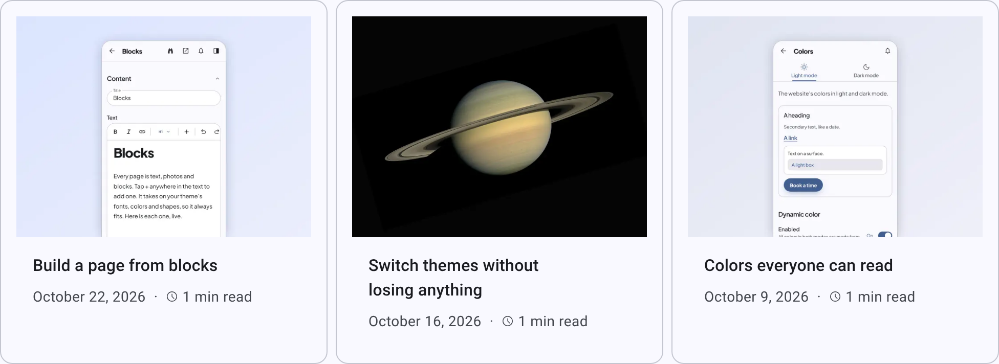
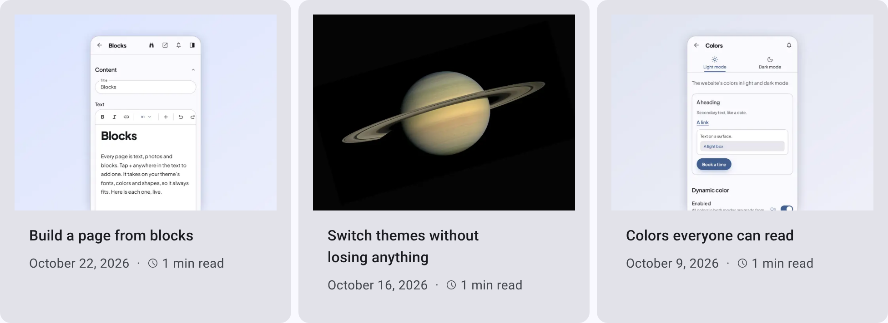

# A list on phones, cards on larger screens (design proposal)

Status: proposal for the owner, 2026-11-17. No code. Written from a talk with the owner on the same day: "a list item may
change into a card on larger screens. Should cards and list basically be the same objects but different design?"

**The answer in short:** the content is the same object, the drawing is not. An item has one content shape. `ListItem`
and `Card` stay the two Material components they are, unchanged in their own design, and one new layout part of the theme,
a **collection**, draws the items as a list below 600 dp and as cards from 600 dp. Text a list item has no room for is left
out of the list; an action never is.

## 1. What Material 3 says

Read on 2026-11-17 on m3.material.io with Playwright (Chromium): `/components/lists/overview`, `/components/lists/specs`,
`/components/lists/guidelines`, `/components/lists/accessibility`, `/components/cards/overview`, `/components/cards/specs`,
`/components/cards/guidelines`, `/components/cards/accessibility`,
`/foundations/layout/applying-layout/window-size-classes`, `/foundations/layout/canonical-layouts/list-detail`,
`/foundations/layout/grids-spacing/grids`. The token tables stay collapsed in a script-less read; no token value is quoted.

### The swap

- Lists, Guidelines, *Swap components*: "Lists are just a compact composition of images, text, and actions. Other
  components, like cards and carousels, use the same elements but take up more space. At larger breakpoints, consider
  swapping a list to a component with a similar purpose to take advantage of available space." The image under it:
  "Information displayed in list items on mobile can change to cards on tablet and desktop."
- Cards, Guidelines, *Small screens*: "On smaller screens with the compact breakpoint, consider swapping cards for lists,
  which can display images and text in a more compact form. Make sure that controls, actions, and other
  component-specific elements are maintained."
- Window size classes: "Use caution when swapping components. Make sure: The interchangeable components are functionally
  equivalent. The component swap serves a functional and ergonomic purpose. Don't swap a button for a chip. Be careful when
  changing between list items and cards." Its table *Common swappable components* lists navigation, dialogs and bottom
  sheet/menu; it does not list list/card.
- Lists, *Compact breakpoints*: "Lists should extend edge-to-edge in compact windows. Selecting a list item should open a
  page with the details." *Medium & expanded*: "a list and the detailed information can appear side-by-side." List-detail:
  compact 1 pane, medium "1 (recommended) or 2 panes", expanded and up 2 panes.

### Showing more or less

- Lists, *Line length*: "A list with a compact breakpoint can become part of a two-column layout at an expanded breakpoint,
  adjusting the amount of information shown in each list item." The image: "Reduce the amount of information shown at
  compact breakpoints."
- Lists, *Swap components*: "Lists can also show more or less content as they scale up and down in size. For example, a
  list item can reveal more content when the component expands." The image: "List items reveal supporting text at expanded
  breakpoints."
- Lists, *Label & supporting text*: "Limit supporting text to one to three lines. Truncate supporting text, depending on
  screen size."

### The two anatomies

| List item (Specs, *Anatomy*: "Container and label text are required. All other elements are optional") | Card (Guidelines, *Anatomy*: "The card container is the only required element") |
| :--- | :--- |
| Container | Container |
| Overline | Subhead ("smaller text elements, such as an article byline or a tagged location") |
| Label text | Headline ("communicates the subject of the card") |
| Supporting text, one to three lines | Supporting text ("body content, such as an article summary") |
| Trailing text ("supplemental details, like a price, count, or date") | none |
| Leading icon, leading avatar, leading media (image or video) | Media: thumbnail ("an avatar or logo"), image, video |
| Trailing icon, trailing selection control | Selection controls ("chips, sliders, checkboxes") |
| Multi-action: "Place supplementary actions, like a bookmark or menu, in the trailing position" | Actions: buttons, icon buttons, linked text, overflow menu ("upper-right or lower-right corner") |
| Divider | Dividers |

### One action or several

- Lists, *Behavior*: a single-action item "performs one action, such as navigating to a new page" and "Can't have secondary
  nested actions"; a multi-action item has "multiple nested actions", the primary one taking "the majority of the space".
- Cards, Accessibility: "A card can be a non-actionable container that holds actions like buttons and links, or it can be
  directly actionable without any buttons or links. This is to avoid stacking actionable elements. An action shouldn't be
  placed on an actionable surface."
- So a single-action list item and a directly actionable card are the same thing; a multi-action list item and a
  non-actionable card with buttons are the same thing.

### Collections and keyboard

- Cards: "Multiple cards can be grouped together into collections displayed in a grid, list, or carousel." "Filter or
  sorting options should be placed outside of the card collection." "In mobile layouts, components such as lists or cards
  are stretched to fit the full width of the screen ... When designing for large screens with an expanded breakpoint, use
  multiple columns to display content."
- Cards, keyboard: Tab moves to the next directly actionable card, or to the next action in a non-actionable card.
  Lists, keyboard: a single-action list is one Tab stop and the arrow keys move between items; multi-action items move with
  the arrow keys between all their actions.
- Cards, Specs: "12dp corner radius", "Left/right padding 16dp", "Padding between cards 8dp max" (ours: the grid gutter,
  `docs/material-deviations.md`, G1).

M3 prints no hybrid list-card component, no name for the part that swaps, and no breakpoint for this swap. It names the
group "collection".

## 2. The design

### 2.1 One content shape, two components

A **collection item** is data, not a component:

```ts
type CollectionItem = {
  headline: string;          // required in both
  subhead?: string;          // a byline, a date, a place
  supporting?: string;       // body text, a summary
  meta?: string;             // a price, a count, a date
  media?: { image: Image; alt?: string } | { icon: string; iconColor?: string } | { video: VideoView };
  href?: string;             // the whole item is one link (single-action / directly actionable)
  actions?: ButtonView[];    // the item's buttons (multi-action / non-actionable with buttons)
  selected?: boolean;
};
```

`href` and `actions` exclude each other, as M3's "an action shouldn't be placed on an actionable surface" says. That is
the rule the Cards block keeps today ("The action area: none on a card with a page", `src/standard/cards/view.ts`).

`ListItem` (`theme/ui/List.tsx`) and `Card` (`theme/ui/Card.tsx`) are not changed in their design and do not learn about
each other. Neither gets a "looks like the other" variant. A theme that restyles one does not restyle the other.

### 2.2 Each field in each component

| Field | As a list item (compact) | As a card (medium and up) |
| :--- | :--- | :--- |
| `headline` | label text (`headline`) | headline |
| `subhead` | overline (`overline`) | subhead |
| `meta` | trailing text (`trailingSupporting`) | in the subhead line, after the subhead |
| `supporting` | supporting text, cut to the lines left (an item is at most three lines) | supporting text, whole |
| `media` image | leading media (`leadingMedia`, the thumbnail) | media at the top (`CardMedia`) |
| `media` icon | leading icon (`leadingIcon`) | thumbnail |
| `media` video | leading video thumbnail (`leadingVideo`); a tap opens the video | video with its play button |
| `href` | single-action item (`href`) | directly actionable card (`href`) |
| `actions`, one with an icon | multi-action item: an icon button trailing (`actions`) | button in the action area |
| `actions`, several or without icons | multi-action item: an overflow menu trailing, one menu item per button | buttons in the action area |
| `selected` | selected item (`selected`) | selected card (`selected`) |

**The rule for leaving out:** only text may be left out of the list, and only after it is mapped: `subhead` goes to the
overline and `meta` to the trailing text before anything is cut. `supporting` is cut first (to two lines, then one, then
none when the overline and headline take the lines). An action, a link, a selection and the media's meaning (its alt text)
are never left out (Cards: "Make sure that controls, actions, and other component-specific elements are maintained").

### 2.3 The collection part

A new layout part in the theme, `theme/ui/Collection.tsx`, shown in the gallery (`#developer/parts/ui`) and exported to
the editor through `src/themeUi.ts`. It takes the items and the card's kind and draws:

- **compact (under 600 dp):** a `List` of `ListItem`s, edge to edge (M3: "Lists should extend edge-to-edge in compact
  windows").
- **medium and up (600 dp):** the `Card`s on the theme grid (`docs/theme-grid.md`: `--grid-columns`, `--grid-gutter`),
  in M3's "multiple columns" (how many: 2.5, L4).

Both are a `<ul>` of `<li>` (`Card as="li"`), so a screen reader hears the same list with the same count in both.

**How it switches.** The site is static HTML, so the switch is CSS, not a script: the collection draws both forms and
shows one. Modern web guidance (`form-factor-adaptation`, `size-aware-styling`, read 2026-11-17 through
`npm run audit:web`): "Use container queries instead of viewport-width media queries for component layout, so a component
adapts wherever it is placed." So the collection is a container (`container: collection / inline-size`) and the switch is
`@container collection (inline-size >= 37.5rem)`, M3's 600 dp, measured on the collection's own width. A collection in a
narrow column stays a list on a wide window; one across the page swaps at 600. Container queries are Baseline since
2023-02-14, no fallback needed. CSS custom properties cannot stand in a container query, so the number is written in
`ui.css` and `lib/breakpoints.test.mjs` checks it against `BREAKPOINTS.medium`.

The form that is not shown is `display: none`: out of the accessibility tree, out of find-in-page, and its images with
`loading="lazy"` are not fetched. Every image in a collection is lazy, unless the collection is the page's first content
(then the shown form's image carries `fetchpriority` as `Img` does today). The editor draws the block's `View.tsx` as the
site does, so the editor and the Preview's window sizes show the swap with no code of their own.

The keyboard follows the form shown: as a list, Tab and the arrow keys of M3's lists; as cards, Tab from card to card or
action to action. Items of links are Tab stops in both, so a site visitor using only links notices no change.

### 2.4 Which places swap

Each is the owner's choice (section 4). Today the content is drawn twice in two ways already:

| Place | Today | Proposed |
| :--- | :--- | :--- |
| Block *Blog posts*, design *List* (`theme/components/PostList.tsx`) | `ListItem`s with leading image, overline (date, reading time), headline, supporting; two columns from expanded | a collection: a list on compact, cards from 600 |
| *Related posts* under a post (`theme/components/PostCard.tsx`, `RelatedPosts.astro`) | three `Card`s on every size | a collection: a list on compact, cards from 600 |
| Block *Cards* (`theme/blocks/cards/LinkCards.tsx`) | cards; on phones `Stacked` or `Carousel` (`docs/superpowers/specs/2026-11-12-cards-carousel-design.md`) | a third value of *On phones*: `List` |
| Block *List* (`theme/blocks/list/Rows.tsx`) | `ListItem`s on every size | unchanged; it is a list by the owner's choice of block |
| The editor's own lists (pages, posts, media, apps) | lists, the Library a grid of cards | not in this proposal: a list in the editor opens an item to edit, which is M3's list-detail, not a swap |

`PostView` (`theme/components/posts.ts`) and `LinkCard` (`src/standard/cards/view.ts`) both map to `CollectionItem` with
no new field: a post's date and reading time are its `subhead`, its description its `supporting`.

### 2.5 The looks: the owner's choice

How the list and the cards look is the owner's decision; nothing in 2.1 to 2.4 fixes it. The screenshots are the real
theme (Material, the demo built on 2026-11-17, the theme's own classes and CSS), with the demo's posts. Each choice is a
value of something the theme has today; none needs a new design. Folder: `2026-11-17-list-to-cards-screens/`.

**L1. The list on phones (412 px).** M3 Lists, Specs: "The standard and segmented styles are a visual choice, and don't
affect a list's behavior." Both are M3 Expressive.

| Standard (today) | Segmented |
| :--- | :--- |
|  |  |

**L2. The card's kind (1024 px).** M3 Cards: "Each provides the same legibility and functionality, so the variant you use
depends on style alone." Related posts are outlined today; the *Cards* block lets the owner choose per block, and keeps
that choice.

| Outlined (today) | Filled | Elevated |
| :--- | :--- | :--- |
|  |  |  |

**L3. The post's description on a card.** The list shows it (two lines); a related post's card does not today. M3 Lists:
"List items reveal supporting text at expanded breakpoints", so a card shows at least what the list shows.

| Without (today) | With (up to three lines) |
| :--- | :--- |
|  |  |

**L4. Cards side by side.** M3 prints no count. Options: 2 from 600 dp and 3 from 840 dp, or 3 from 600 dp (related posts
today).

**L5. The image's shape on a card.** 4:3 (related posts today) or 3:2 (the *Cards* block's default).

## 3. What it costs

- **A new theme component.** The developer rule (`developer` skill, *No own components*) needs the owner's yes before a
  session builds `Collection`; this spec is that request. It uses `List`, `ListItem`, `Card`, `CardMedia`, `Menu` and the
  grid as they are.
- **HTML size.** Each item is in the page twice. For 3 related posts or 12 posts this is a few kB; the images are not
  doubled (lazy, one shown).
- **No deviation** from Material 3 if the owner takes the defaults below. The 600 dp line is M3's compact/medium line; the
  measure on the container is the modern web rule, which comes first (priority 1).
- **Checks:** `check:screens` gets each place on a compact and a medium width; `check:themes` checks that a theme styles the
  collection in both forms; `npx morpheme check:demo`. A release note for each place a site owner sees change.

## 4. For the owner to decide

1. **The approach:** one content shape, `ListItem` and `Card` unchanged, a new theme part `Collection` that swaps them.
   Yes or no.
2. **Where:** *Blog posts* (list design), *Related posts*, *Cards* (`On phones: List`). Any or all.
3. **Measured on:** the collection's own width (modern web, recommended) or the window (M3's window size classes).
4. **Several buttons in a list item:** an overflow menu (recommended, M3's trailing menu), or only the first button as an
   icon button with the rest left to the card. The second leaves actions out on phones, against the Cards rule quoted above.
5. **The looks** (2.5): L1 standard or segmented list, L2 outlined, filled or elevated cards, L3 the description on a
   card or not, L4 how many cards side by side, L5 the image's shape.
