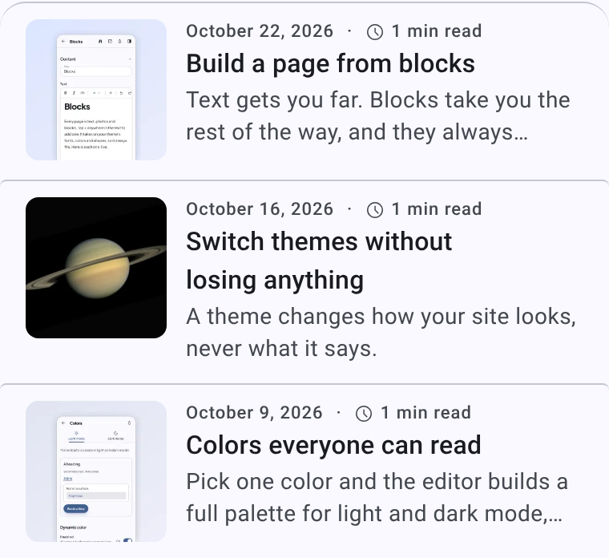
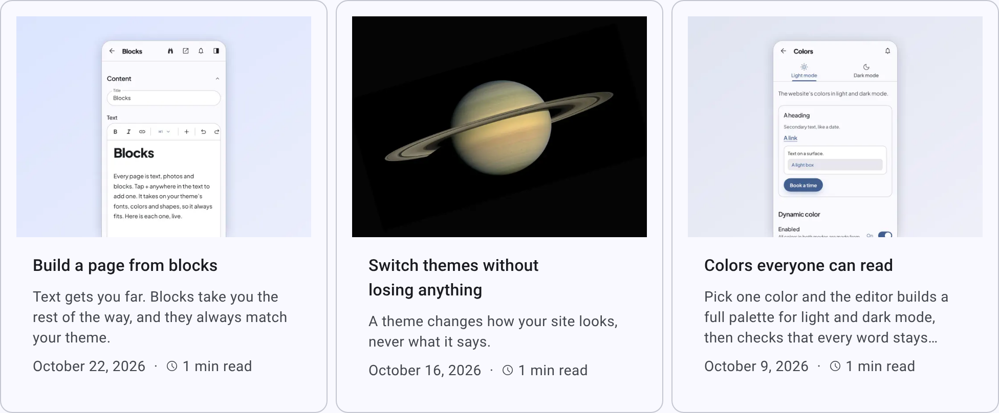

# 0.19 Cards and lists (design)

Status: brainstorm with the owner, 17 November 2026. **Waiting for the owner's approval as a whole**, with the plan
`docs/superpowers/plans/2026-11-17-cards-and-lists-0-19.md`. Section 9 holds the last decisions. No code. Roadmap: `docs/superpowers/plans/2026-11-14-roadmap-0-18-to-0-24.md`,
*0.19 Cards and lists*.

It started from the owner's question: "According to M3, a list item may change into a card on larger screens. Should cards
and lists basically be the same objects but different design?" The owner's answer, in the talk: Material 3's card and list
item made one to one, and every card and list built on them; nothing stays out.

## 1. The rules (owner, 17 November)

- **Follow the M3 token.** Where a token prints a value, that value is used.
- **No invented tokens; use the globals.** A part reads the global tokens. **If it does not fit, ask the owner.**
- **Names.** Every global is `--mo-` and M3's system token name (`md.sys.color.secondary` is `--mo-color-secondary`).
- **Component variables, for a customizer.** The owner will build a customizer that changes things per component. Each value
  of a component is one variable, `--<component>-<M3 part>-<property>`, named after M3's component token where M3 has one
  (`md.comp.elevated-card.container.color` is `--card-elevated-container-color`), falling back to a global
  (`var(--card-padding, var(--mo-space-200))`). Where M3 prints none, the name follows the same pattern and the spec marks it
  "ours, M3 silent".
- **M3 Expressive** where a component has it (Lists), else baseline (Cards have no Expressive variant: the four card pages
  were searched; "expressive" appears only for the container transform of "hero moments").
- **Standard and reusable.** One rule for all parts, reused; no special case for one component.
- **Tailwind goes** (section 7).

## 2. Step 0: M3's names for the globals

Every global becomes `--mo-` and M3's system token name; a clean break (no aliases). It replaces the colour names of
`plans/2026-11-08-md3-color-variable-names.md` (colours named without M3's `color.` group).

| M3 system token | Today | Step 0 | Uses today |
| :--- | :--- | :--- | :--- |
| `md.sys.color.*` | `--mo-secondary` | `--mo-color-secondary` | 673 in 14 files |
| `md.sys.shape.corner.*` | `--mo-shape-medium` | `--mo-shape-corner-medium` | 189 in 8 files |
| `md.sys.elevation.level*` | `--mo-elevation-1-…` | `--mo-elevation-level1-…` | 265 in 10 files |
| `md.sys.state.*` | none (step 1) | `--mo-state-hover-state-layer-opacity` … | new |
| spacing `space100` … | `--mo-space-100` | unchanged | 63 in 4 files |

Themes (Venus in `morpheme-apps`, whose `scripts/variable-names.test.mjs` checks the names) and apps that set the old names
break: `THEME_API` and `APP_API` go up, and the release note lists the old and new names.

## 3. Step 1: the shared globals

- **Shadows at rest: on, at every level** (owner: "Follow the token: 1dp shadow at rest"; then "one global rule"). Each
  `--mo-elevation-levelN-rest-shadow` is that level's shadow. A part names its level and never writes its own shadow. The
  card's own shadow variables go. Every part on level 1 or higher is checked against its own M3 token page in the same pull
  request. It replaces the M3 audit's decision of 13 November (colour-only elevation at rest).
- **State opacities: M3's five, as globals.** m3.material.io/foundations/interaction/states/state-layers, token set *State
  opacities*: hover 0.08, focus 0.1, pressed 0.1, dragged 0.16, disabled 0.38. Every part reads them instead of a written
  number. A component's own value that is not in the set (the outlined card's disabled outline, 0.12) is the component's,
  from its token table.
- **One focus ring** for every part, 3 dp, offset 2 dp, following the focused part's own corner (`border-radius: inherit`).
  Its colour is `--mo-color-primary` (section 9, 1). A component's own offset from its token table (the list's −3 dp, inside) is a
  component variable.

## 4. Step 2: Avatar

M3 has no avatar component (`/components/avatar` is 404; not on the components index). It is a part of others: Lists, "Leading
avatar container", "images in circular or expressive shapes to represent a person or entity"; Cards, "thumbnails for an
avatar or logo". One shared theme part, `Avatar` (a letter or an image), lifted out of `ListItem`, used by the list's
leading avatar and the card's thumbnail. List tokens: 40 dp, circular, `primary-container` / `on-primary-container`, label
16 pt / 0.15. In the components list as "M3 has no page", as `ImageTile` and `Lightbox`. Owner: agreed.

## 5. Steps 3 and 4: Card

### 5.1 M3 against ours

Read on m3.material.io/components/cards (Overview, Specs with the token tables opened and previews hidden, Guidelines,
Accessibility). The token values are the baseline scheme's; written here as roles. Elevation in dp is the level (0, 1, 3, 6,
8 dp are levels 0 to 4).

| Token | Elevated | Filled | Outlined | Ours today |
| :--- | :--- | :--- | :--- | :--- |
| Container | `surface-container-low`, level 1 | `surface-container-highest`, level 0 | `surface`, level 0, outline 1 dp `outline-variant` | elevated ✓ but no shadow at rest; filled `surface-container-high` ✗; outlined ✓ |
| Shape | 12 dp | 12 dp | 12 dp | ✓ (`--block-radius` 0.75rem) |
| Padding | 16 dp (Specs, measurements) | | | ✓ |
| Hover | level 2, layer 0.08 | level 1 | level 1 | ✓ |
| Focus | level 1, layer 0.1, ring `secondary` 3 dp offset 2 dp | level 0 | level 0, outline `on-surface` | layer ✓; ring `primary`; outline stays `outline-variant` ✗ |
| Pressed | level 1, layer 0.1 | 0 | 0 | ✓ (ripple) |
| Dragged | level 4, layer 0.16 | level 3 | level 3 | levels ✓, layer not set ✗ |
| Disabled | level 1, 0.38, `surface` | 0, 0.38 | outline `outline` 0.12 | none ✗ |
| Icon | `primary`, 24 dp | | | no slot ✗ |

### 5.2 Decisions

- **Type styles** (M3 prints none for cards). Headline **title-large** (22 / 28, 400; owner: body-large "is too small"; title
  medium is the same 16 px). Subhead **label-small**, supporting text **body-medium**, meta **label-small**: the list item's
  M3 tokens. Recorded in `docs/material-deviations.md` as our choice where M3 is silent.
- **Spacing:** the global M3 spacing steps, today's values, through component variables (section 1): padding
  `--mo-space-200` (M3's 16 dp), media to headline `--mo-space-200`, headline to subhead `--mo-space-50`, to supporting text
  `--mo-space-100`, text to actions `--mo-space-200`. The gaps are "ours, M3 silent". Today's `--card-media-gap`,
  `--card-subhead-gap`, `--card-text-gap`, `--card-action-gap` are renamed to the pattern.
- **Today's `--card-*` variables** are renamed to M3's names (`--card-elevated-container-color` …); themes that set them
  break (`THEME_API`).
- **A link card or a card with actions, never both** (M3 Cards, Accessibility: "An action shouldn't be placed on an
  actionable surface"). `Card`'s types make both impossible.
- **The anatomy as named props**, the same names as `ListItem` where they mean the same:

| Prop | M3 part |
| :--- | :--- |
| `headline` | Headline |
| `subhead` | Subhead (the list's overline; one name, decided C1) |
| `supporting` | Supporting text |
| `media` (image, video), `thumbnail` (`Avatar`), `icon` | Media, thumbnail, icon |
| `actions` | Buttons, icon buttons, selection controls (chips, sliders, checkboxes), linked text |
| `menu`, `menuAt` (top or bottom) | Overflow menu ("upper-right or lower-right corner") |
| `href` | Directly actionable (never with `actions`) |
| `selected`, `disabled` | States |
| `children` | "Can also contain other components" (a table, a price list), between the text and the actions |

  `Card` draws them in M3's order with the spacing and type above. Dividers come by themselves: inset between content and
  actions, full-width above content that expands (M3: "Use full-width dividers for content that can be expanded").

### 5.3 Step 4: every user of Card

Released with step 3, so `THEME_API` goes up once and no block draws the old card. The site: *Cards*, *Price cards*,
*Notice*, *Table*, *Cookie list*, the panels (`Panel.tsx`, *Links*), *Image grid* (`ImageTile`), *Testimonials*, related
posts (`PostCard.tsx`), the 404 page. The editor: the start screen's widgets, the inline Cards, Price cards, Notice and Table,
the media screen, the notices. The theme grid's move of the cards (deviation G1, "the cards move in later pull requests") is
done here.

## 6. Step 5: List and ListItem

M3 Lists has an Expressive variant (Specs: "Baseline lists … Not recommended. Use expressive lists instead"). Token sets read:
*List - Common* and *List - Expand*.

### 6.1 Where ours differs from the tokens (follow the token)

| Part | M3 token | Ours |
| :--- | :--- | :--- |
| Height, one / two / three lines | 56 / 72 / 88 dp | 48 px minimum and padding |
| Leading and trailing space; top and bottom; between | 16; 10; 12 dp | 0; about 14; 24 px |
| Hover | `on-surface` layer 0.08, text unchanged | text turns `primary`, no layer, what trails moves 3 px |
| Selected | `secondary-container` / `on-secondary-container` | standard: text `primary`, weight 500 |
| Disabled | 0.38 (state layer 0.1) | 0.6 |
| Focus ring | `secondary`, 3 dp, offset −3 dp | `primary` |
| Shape (Expressive) | 4 dp; hovered 12; focused, pressed, dragged, selected 16 | 0 standard; segmented 4 throughout |
| Segmented | container `surface`; gap 2 dp | `surface-container-high`; 3 px |
| Dragged | 8 dp (level 4), layer 0.16 | not set |
| Divider | `outline`, 1 dp | to check |
| Expand | expanded container `surface`; trailing icon in a circular container, `surface-container-low` when open | to check |
| Avatar 40 dp, image 56 dp (expressive corner 8), video 114 × 64, icons 20 dp (Expressive), type: label body-large, supporting body-medium, overline and trailing label-small | ✓ |

### 6.2 Ours, not M3's (proposal, not yet decided)

`columns` (headline and text side by side on a wide screen), `truncate`, the 3 px hover shift, selected weight 500. Proposal:
remove the hover shift and the weight (not in the tokens); `columns` and `truncate` are section 9, Q6.

### 6.3 Decided

- **C1:** the small line by the headline is one prop, `subhead`; the list draws it as its overline (above the headline), the
  card as its subhead (under it).
- The blog list's headline (today title-medium) follows the list token (body-large).

## 7. Tailwind goes

About 1,700 utility uses in 243 files, 156 window-width variants (`medium:` …), `@tailwindcss/typography` (`prose`, the page's
own text), the packages `tailwindcss`, `@tailwindcss/vite`, the typography and Prettier plugins. Owner, 17 November:

1. From now on, new or changed code uses no Tailwind.
2. Steps 3 to 6 write their CSS without it, with container queries (Modern web guidance, `form-factor-adaptation`: "Use
   container queries instead of viewport-width media queries for component layout").
3. A last step replaces `prose` with the theme's own text styles, rewrites what is left, removes the packages and raises
   `THEME_API` and `APP_API`.

It takes over the M3 audit's pull request 11 (type).

## 8. Steps 6 and 7

### 8.1 Step 6: the collection

List and cards turn into each other both ways; every card and list goes through it, nothing stays out. The same item (the
props of 5.2) goes to `ListItem` or `Card`. It takes over the old 0.19's *Dynamic cards* and *A card layout for the List block*.

**The card's anatomy in the list** (owner: "Convert the anatomy of cards to lists"):

| Card | List item | |
| :--- | :--- | :--- |
| Container; thumbnail; image; video; icon | Container; leading avatar; leading image; leading video; leading icon | ✓ |
| Headline; subhead; supporting text | Label text; overline; supporting text (1 to 3 lines) | ✓ |
| Primary action area | Single-action item | ✓ |
| Icon buttons; overflow menu; checkbox, radio, switch | Trailing icon buttons; trailing menu; selection control | ✓ |
| Selected, disabled, dragged | The same | ✓ |
| Buttons | none | Q2 |
| Chips, sliders | none | Q3 |
| Linked text | not on a whole-row link (M3 Lists: "Don't add interactive elements that make the list item difficult to navigate") | Q4 |
| Dividers inside a card | dividers are between items | Q5 |
| Other components (`children`) | only content that folds out (`expand`) | Q5 |

**The list item's anatomy in the card:** trailing text (a price, a date) and the trailing icon have no place on an M3 card
(Q7).

**How it switches (the proposal of the first version, to check against "both ways"):** a container query on the collection's
own width at M3's 600 dp (`@container collection (inline-size >= 37.5rem)`); each collection says its form on phones and on
larger screens (List or Cards; the Cards block also Carousel on phones). The site draws both forms and shows one
(`display: none` keeps the other out of the accessibility tree; its lazy images are not loaded). Both are a `<ul>` of `<li>`.

**The looks** (the owner's choice; screenshots of the real theme in `2026-11-17-list-to-cards-screens/`): L1 standard or
segmented list; L2 outlined, filled or elevated cards; L3 the description on a card; L4 how many cards side by side; L5 the
image's shape.

| Standard list | Segmented list |
| :--- | :--- |
|  |  |

| Outlined | Filled | Elevated (today: no shadow at rest) |
| :--- | :--- | :--- |
|  |  |  |

### 8.2 Step 7: viewports in the builder

Owner: remove the Preview and let the builder show the page at different viewports. Today the Preview (`pagePreview.tsx`,
`PreviewScreen.tsx`, `previewBreakpoints.ts`) shows the whole page (header, footer, layout) in a sandboxed frame at M3's five
window sizes; the builder (`MarkdownEditor.tsx`) draws the text and its blocks only. To decide in its design: the builder's page
in its own frame, or the theme on container queries (after Tailwind is gone, the second is possible); the whole page in the
builder; wide sizes on a phone (scaled, perhaps view only); which previews go (page and post; header, footer and part
previews; Google's result preview stays). Needs a design, after Tailwind is gone.

## 9. The last decisions

Owner, 17 November: "Lists are more simple. Not all cards should be convertible. No need to ask me." The session decided the
rest; the owner approves the whole with the plan (`plans/2026-11-17-cards-and-lists-0-19.md`).

1. **Focus ring:** `--mo-color-primary`, a deviation quoting M3's `secondary` token and WCAG 2.2, 1.4.11 (a site's Secondary can
   give 1.15:1; `specs/2026-11-13-custom-colors-design.md`). Modern web comes before M3.
2. **Buttons** (owner): one is a single-action item; several are an expanding item with each a nested single-action item.
3. **Chips and sliders** (owner): they do not belong in a list. A collection whose cards have them offers Cards only.
4. **Linked text** (owner): a link in the text is one of the card's actions, as in 2; in the row the text is plain.
5. **Inner dividers** are not drawn in the list form. **Other components** (`children`) as 3: Cards only (*Price cards*, *Table*).
6. **`columns`** is removed (not in M3's anatomy). **`truncate`** stays (M3: text "can wrap or be truncated").
7. **A list item as a card:** trailing text at the end of the subhead line; the trailing icon is not drawn.
8. **Scope:** every group of items on the site and the editor's lists of content go through the collection. Single cards, lists
   inside another component and the editor's settings rows use `Card` and `ListItem` but do not convert.
9. **Looks:** standard list (segmented where a block offers it); the block's card kind, default outlined; the description on
   cards; 2 cards side by side from 600 dp, 3 from 840 dp; each block's own image shape.
10. **Branches:** the `0.19` branch (the old *Lists and data*, 202 commits) becomes `0.20`; a new `0.19` is cut from `0.18`.
11. **Other documents** keep their numbers until they are next changed; the roadmap's note says to add one.

## 10. Sources read

m3.material.io with Playwright, 17 November 2026: `/components/cards/{overview,specs,guidelines,accessibility}` (token tables
opened, previews hidden), `/components/lists/{overview,specs,guidelines,accessibility}` (*List - Common*, *List - Expand*),
`/foundations/interaction/states/state-layers`, `/foundations/interaction/states/applying-states`,
`/styles/typography/type-scale-tokens`, `/styles/typography/applying-type`,
`/foundations/layout/applying-layout/window-size-classes`, `/foundations/layout/canonical-layouts/list-detail`,
`/foundations/layout/grids-spacing/grids`, `/components` (index) and `/components/avatar/overview` (404). Modern web guidance
(`npm run audit:web`): `size-aware-styling`, `form-factor-adaptation`.
